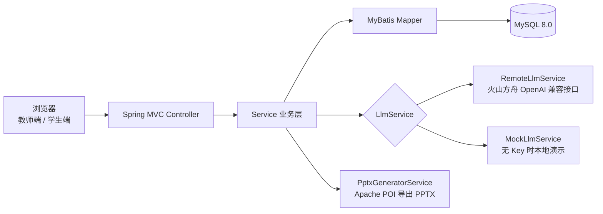

# 智绘课成

> 基于大模型的课件生成与教学管理平台

“智绘课成”是一个面向高校课堂的 AI 动画课件平台。教师输入知识点后，系统调用大模型生成可交互的动画课件，并完成课程归档、班级发布、作业批阅、成绩统计与教学反馈；学生可以在线学习动画、作答提交、查看成绩与错题回顾。

本项目为大连科技学院软件工程专业本科毕业设计作品。

## 目录

- [1. 项目简介](#1-项目简介)
- [2. 功能一览](#2-功能一览)
- [3. 技术栈](#3-技术栈)
- [4. 项目结构](#4-项目结构)
- [5. 快速开始](#5-快速开始)
- [6. 使用流程](#6-使用流程)
- [7. 核心业务规则](#7-核心业务规则)
- [8. 页面与接口](#8-页面与接口)
- [9. 数据库设计](#9-数据库设计)
- [10. 构建与部署](#10-构建与部署)
- [11. 常见问题](#11-常见问题)
- [12. 安全与提交说明](#12-安全与提交说明)
- [13. 作者](#13-作者)

---

## 1. 项目简介

传统课件制作需要教师投入大量时间做排版、绘图和动画。本项目把“知识点 → 动画课件 → 课堂任务 → 学生学习 → 作业批阅 → 成绩分析”串成一条完整链路：

1. 教师创建课程，输入知识点，调用大模型生成 HTML 动画课件；
2. 系统按知识点智能归入对应课程，也支持教师手动调整；
3. 教师把课件发布为班级任务，设置截止时间；
4. 学生在任务页观看动画、确认学完后作答；
5. 客观题自动判分，主观题由教师批阅，可打回重做或单独顺延补交；
6. 教师查看待批阅、已批阅、成绩排名、成绩分布和导出数据；
7. 学生查看成绩、错题回顾、教师评语，并提交课件评价或疑问。

### 系统架构



前端不依赖 Node.js 构建，所有页面都是 `src/main/resources/static` 下的静态 HTML/CSS/JS，由 Spring Boot 直接提供。

---

## 2. 功能一览

### 教师端

| 模块 | 主要能力 |
| --- | --- |
| 工作台 | 课程数、班级数、课件数、待批阅数量等教学概览 |
| 课程管理 | 新建/编辑/删除课程；按课程归档课件；查看课程下课件清单 |
| 课件生成 | 输入知识点生成动画课件；查看生成结果；下载 PPTX；删除课件 |
| 我的课件 | 按学科分组、折叠展开、搜索筛选；预览、收藏、共享 |
| 共享广场 | 发布/下架共享课件；浏览、收藏他人的共享课件；一键使用 |
| 班级管理 | 新建/编辑/合并/删除班级；添加、移除、转班学生；学生搜索 |
| 发布任务 | 按班级和课件发布任务；设置截止时间；支持全部班级逐班发布 |
| 批阅作业 | 待批阅/已批阅汇总；客观题自动判分；主观题评分；打回重做；单独顺延 |
| 催交提醒 | 对未提交学生批量催交；学生通知栏接收；重复催交去重 |
| 成绩单 | 按课程/任务筛选；排名、平均分、最高分、成绩分布；CSV 导出 |
| 学生反馈 | 按课程和课件筛选评价/疑问；查看反馈详情 |
| 通知中心 | 学生提交作业、学生反馈等事件通知；未读红点；全部已读 |
| 个人设置 | 修改姓名、手机号、邮箱、密码 |

### 学生端

| 模块 | 主要能力 |
| --- | --- |
| 通知 | 登录默认进入通知页，查看教师催交和系统提醒 |
| 我的任务 | 未完成/已完成筛选；按课程查看任务；倒计时；进入学习 |
| 动画学习 | 播放课件动画；服务端记录有效学习时长；确认学完后进入作答 |
| 在线作答 | 客观题选择、主观题输入；提交后即时更新任务状态 |
| 我的成绩 | 按课程筛选；查看总分、排名、教师评语；下钻查看逐题作答与错题 |
| 共享广场 | 浏览教师共享课件；收藏；查看动画 |
| 我的反馈 | 对课件提交评价或疑问；按课程/课件筛选；编辑、删除本人反馈 |
| 个人资料 | 查看账号数据；修改姓名、手机号、邮箱、密码 |

---

## 3. 技术栈

| 层次 | 技术 |
| --- | --- |
| 后端框架 | Spring Boot 3.5.16 |
| 运行环境 | Java 17+ |
| 持久层 | MyBatis 3.0.3 + MySQL 8.0 |
| 会话与权限 | HttpSession + 登录拦截器；BCrypt 密码哈希 |
| 大模型 | 火山方舟 OpenAI 兼容 `chat/completions` 接口；无 Key 自动切换 Mock |
| PPTX 导出 | Apache POI 5.2.5 |
| 前端 | 原生 HTML5 / CSS3 / JavaScript；无独立打包步骤 |
| 构建 | Maven Wrapper（`mvnw` / `mvnw.cmd`） |

---

## 4. 项目结构

```text
online-course-ai/
├── src/main/java/com/example/onlinecourseai/
│   ├── common/          # 统一返回体、业务异常、全局异常处理
│   ├── config/          # 登录拦截器、Web 配置
│   ├── controller/      # 12 组 REST 接口
│   ├── dto/             # 接口出入参对象
│   ├── entity/          # 数据库实体
│   ├── mapper/          # MyBatis Mapper 接口
│   └── service/         # 业务接口与实现
├── src/main/resources/
│   ├── application.properties
│   └── static/
│       ├── index.html              # 登录/注册入口
│       ├── course-generate.html    # 教师端
│       ├── student.html            # 学生端
│       ├── profile.html            # 学生个人资料
│       ├── teacher-profile.html    # 教师个人设置
│       ├── favicon.png
│       ├── terra-nova-bg.mp4       # 首页浅色背景
│       ├── orange-flower-bg.mp4    # 首页深色背景
│       └── assets/gp3/             # 3D 书架课件封面 b01–b12
├── sql/
│   ├── create.sql                  # 16 张表的建库建表脚本
│   ├── demo-data.sql               # 演示数据（仅数据）
│   ├── 02_insert_students.sql      # 分批种子脚本（可选）
│   ├── 03_insert_tasks.sql
│   ├── 04_insert_grades.sql
│   ├── 05_insert_new_classes.sql
│   ├── 06_insert_test_accounts.sql
│   ├── courseware_share.sql
│   └── feedback_data.sql
├── pom.xml
├── mvnw
├── mvnw.cmd
└── README.md
```

> `sql/demo-data.sql` 是完整演示数据，适合直接导入空库；`02`–`06` 是开发过程中分批使用的种子脚本，只有在对应基础数据已存在时才建议执行。

---

## 5. 快速开始

### 5.1 环境要求

- JDK 17 或更高版本
- MySQL 8.0
- 现代浏览器（Chrome / Edge / Firefox）
- 可选：火山方舟 API Key（不配置时自动使用 Mock 演示课件）

检查环境：

```bash
java -version
mysql --version
```

### 5.2 初始化数据库

`create.sql` 会自动创建 `course_ai` 数据库和 16 张表。首次安装建议使用空库：

```bash
mysql -u root -p < sql/create.sql
mysql -u root -p --default-character-set=utf8mb4 course_ai < sql/demo-data.sql
```

Windows PowerShell 不支持 `<` 输入重定向，可使用：

```powershell
cmd /c "mysql -u root -p < sql\create.sql"
cmd /c "mysql -u root -p --default-character-set=utf8mb4 course_ai < sql\demo-data.sql"
```

如果只需要空库，不导入演示数据，执行第一条即可。

演示数据包含：

- 213 个用户（教师/学生）
- 8 个班级、9 门课程
- 31 个动画课件、35 个教学任务
- 作答记录、成绩、学习记录、反馈、共享与收藏数据

导入后可使用测试账号直接体验：

| 角色 | 用户名 | 密码 |
| --- | --- | --- |
| 教师 | `teacher_test` | `123456` |
| 学生 | `student_test` | `123456` |

### 5.3 修改数据库连接

编辑 `src/main/resources/application.properties`：

```properties
spring.datasource.url=jdbc:mysql://localhost:3306/course_ai?useSSL=false&serverTimezone=Asia/Shanghai&characterEncoding=utf8&allowPublicKeyRetrieval=true
spring.datasource.username=root
spring.datasource.password=123456
```

把用户名和密码改成自己 MySQL 实例的配置。数据库名保持 `course_ai`，或者同步修改建库脚本和连接串。

### 5.4 配置大模型（可选）

`llm.api-key` 不写死在源码里，通过环境变量注入：

```properties
llm.api-key=${LLM_API_KEY:}
llm.model=doubao-seed-2-1-pro-260628
```

PowerShell 临时设置：

```powershell
$env:LLM_API_KEY="你的火山方舟 API Key"
.\mvnw.cmd spring-boot:run
```

IntelliJ IDEA：在 `Run → Edit Configurations → Environment variables` 中添加 `LLM_API_KEY=你的 Key`。

不配置 Key 时，`pickLlm()` 会自动使用 `MockLlmService`，仍可完整演示“生成课件 → 发布任务 → 学生学习 → 批阅 → 成绩”的流程，只是课件内容是内置示例。

### 5.5 启动应用

```bash
# Windows
mvnw.cmd spring-boot:run

# macOS / Linux
./mvnw spring-boot:run
```

默认端口 `8080`，浏览器打开：

```text
http://localhost:8080
```

首页是登录/注册入口。教师登录后进入 `course-generate.html`，学生登录后进入 `student.html`。

### 5.6 打包运行

```bash
mvnw.cmd clean package -DskipTests
java -jar target/online-course-ai-0.0.1-SNAPSHOT.jar
```

指定端口：

```bash
java -jar target/online-course-ai-0.0.1-SNAPSHOT.jar --server.port=8081
```

---

## 6. 使用流程

### 6.1 教师端

#### 第一步：创建课程

进入“课程管理”，新建课程，填写课程名称、课程代码、学分、学期和说明。课程用于后续课件的学科归档和成绩筛选。

#### 第二步：生成动画课件

进入“课件生成”：

1. 输入知识点，例如“二分查找”“牛顿第二定律”“勾股定理”；
2. 选择或填写课程信息；
3. 点击生成，等待大模型返回动画 HTML；
4. 生成完成后可在中间工作台预览，右侧查看知识点、摘要和题目；
5. 可下载 PPTX，或删除不需要的课件。

系统会尝试根据知识点自动归入课程；自动归科只处理尚未归科的课件，不会覆盖教师手动调整的结果。

#### 第三步：维护班级

进入“班级管理”：

- 新建班级；
- 搜索学生并加入班级；
- 支持移除学生、转班、合并班级；
- 班级学生清单支持增删改查。

#### 第四步：发布任务

进入“发布任务”：

1. 按学科筛选课件；
2. 选择目标班级，可勾选“全部班级”逐班发布；
3. 设置截止时间；
4. 发布后任务出现在学生“我的任务”中。

同一班级重复发布同一课件会被拦截，提示“该班级已发布过这份课件，请勿重复发布”。

#### 第五步：批阅作业

进入“批阅作业”：

- 顶部按“待批阅 / 已批阅”切换；
- 待批阅按课程分组，点开后可查看学生答题；
- 客观题由系统自动判分，主观题由教师打分；
- 可填写评语；
- 对需要重做的学生执行“打回重做”，并可单独设置补交截止时间；
- 对未提交学生可一键催交，或单独顺延补交。

#### 第六步：查看成绩与导出

进入“成绩单”：

- 按课程、任务筛选；
- 查看平均分、最高分、排名、成绩分布；
- 点击课程条可下钻查看该课程各次成绩；
- 支持导出 CSV。

成绩排名只统计已批阅（`GRADED`）的记录；批阅中（`REVIEWING`）不会进入排名和成绩分布。

#### 第七步：处理学生反馈

进入“学生反馈”：

- 按课程、课件筛选；
- 查看学生对课件的评价和疑问；
- 教师只能查看自己名下课件的反馈，不能修改或删除学生反馈。

#### 第八步：共享课件

在“我的课件”中选择课件发布到共享广场；其他教师可浏览、收藏、使用。取消共享后从广场下架，但不会删除原课件。

### 6.2 学生端

#### 第一步：查看通知

学生登录后默认进入“通知”页，可看到教师催交提醒和系统通知。点击通知可跳转到对应任务。

#### 第二步：进入学习

在“我的任务”中：

- 使用“未完成 / 已完成”筛选；
- 按课程筛选；
- 查看截止倒计时；
- 点击任务进入动画学习。

#### 第三步：学习并确认

动画在页面中间工作台播放。系统按心跳累计有效学习秒数；学生点击“我已学完”后进入作答。已提交后不再累计学习时长。

#### 第四步：在线作答

- 客观题选择选项；
- 主观题输入文字；
- 提交后任务状态即时变为已完成，并从“未完成”列表移出。

任务关闭或超过截止时间后不能提交；如果教师单独顺延，学生在顺延窗口内仍可补交。

#### 第五步：查看成绩与错题

进入“我的成绩”：

- 按课程筛选；
- 查看总分、排名、教师评语；
- 点击成绩条下钻，在中间工作台查看逐题作答、标准答案和错题对比。

#### 第六步：反馈与收藏

- 在课件详情中提交评价或疑问；
- 在共享广场收藏课件；
- 在“我的反馈”中按课程/课件筛选、编辑或删除本人反馈。

---

## 7. 核心业务规则

1. **一课件一班一任务**：`task` 表对 `(class_id, animation_id)` 建唯一索引，同一班级不能重复发布同一课件。
2. **截止后禁止提交**：任务关闭或超过截止时间后，学生不能新进入作答或提交；教师可对个别学生单独顺延补交。
3. **打回重做**：教师打回后，学生需要重新提交；可同时设置该生的补交截止时间，不影响全班。
4. **催交去重**：同一教师对同一任务、同一学生重复催交时，只保留最新一条有效提醒，学生通知栏不重复堆积。
5. **排名口径**：排名、平均分、最高分、成绩分布只统计 `GRADED`；`REVIEWING` 不计入。
6. **学习时长**：由服务端心跳累计，前端只负责触发；历史任务不回填旧学习秒数，新进入任务后开始累计。
7. **智能归科**：只处理 `course_id IS NULL` 的课件，不覆盖教师手工归课。
8. **反馈可见性**：学生只能查看/编辑/删除自己的反馈；教师只能查看与自己课件相关的反馈。
9. **共享独立性**：共享广场的上下架状态与课件本身的状态解耦，取消共享不会删除课件。
10. **登录身份校验**：登录时选择的“教师/学生”身份必须与账号实际角色一致。

---

## 8. 页面与接口

### 页面

| 页面 | 路径 | 说明 |
| --- | --- | --- |
| 登录/注册 | `/` 或 `/index.html` | 角色选择、登录、注册 |
| 教师端 | `/course-generate.html` | 教师全部教学功能 |
| 学生端 | `/student.html` | 学生任务、学习、成绩、反馈 |
| 学生个人资料 | `/profile.html` | 学生账号信息与密码 |
| 教师个人设置 | `/teacher-profile.html` | 教师账号信息与密码 |

### 接口分组

所有接口统一返回：

```json
{ "code": 200, "message": "success", "data": ... }
```

未登录访问 `/api/**` 返回 `401`，前端跳转登录页。

| 前缀 | 职责 |
| --- | --- |
| `/api/auth` | 注册、登录、退出、当前用户、资料、密码 |
| `/api/ai` | 生成课件、我的课件、详情、摘要、更新、答题、删除、PPTX 下载 |
| `/api/courses` | 课程增删改查、搜索、智能归科、课程课件、移动课件 |
| `/api/classes` | 班级增删改查、学生增删、转班、搜索、合并 |
| `/api/tasks` | 发布/更新/删除/开关任务、搜索、我的任务、学习心跳、任务详情 |
| `/api/tasks/{id}/...` | 提交、我的作答、批阅、打回、顺延、催交、通知 |
| `/api/grades` | 我的成绩、任务排名、成绩分析 |
| `/api/feedback` | 提交反馈、按课件查询、我的反馈、教师反馈、编辑、删除 |
| `/api/share` | 发布/下架共享、我的共享、广场、收藏、使用共享课件 |
| `/api/student` | 学生课件分组 |
| `/api/notify` | 我的通知、单条已读、全部已读 |
| `/api/teacher` | 教师工作台看板 |

---

## 9. 数据库设计

数据库：`course_ai`，字符集 `utf8mb4`。

| 表 | 说明 |
| --- | --- |
| `sys_user` | 教师/学生账号，含姓名、手机号、邮箱、性别、年级、专业 |
| `class_info` | 班级，关联创建教师 |
| `enrollment` | 学生-班级多对多选课关系 |
| `course` | 教师课程，含课程名称、代码、学分、学期 |
| `animation` | 课件，保存大模型生成的 HTML、摘要、状态、归属课程 |
| `task` | 教学任务，关联班级和课件，含截止时间与状态 |
| `question` | 课件配套题目，含客观题选项、答案、类型、分值 |
| `answer_record` | 学生逐题作答记录 |
| `grade` | 每任务每学生一条成绩汇总，含主观分、评语、批阅状态 |
| `task_study_record` | 学习记录，含有效学习秒数、确认状态、首次打开/确认时间 |
| `courseware_feedback` | 学生对课件的评价与疑问 |
| `courseware_share` | 课件共享记录，含学科、说明、浏览/收藏数、上下架状态 |
| `courseware_favorite` | 教师收藏共享课件 |
| `task_submit_extension` | 教师给单个学生顺延的补交截止时间 |
| `task_remind` | 教师催交提醒 |
| `teacher_notification` | 教师通知，含作业提交和课件反馈事件 |

建表脚本：`sql/create.sql`。演示数据：`sql/demo-data.sql`。

---

## 10. 构建与部署

### 本地构建

```bash
mvnw.cmd clean package -DskipTests
```

产物：

```text
target/online-course-ai-0.0.1-SNAPSHOT.jar
```

当前版本 jar 约 70 MB，已包含前端静态资源（含两段首页背景视频）。

### 服务器部署

1. 安装 JDK 17+ 和 MySQL 8.0；
2. 导入 `sql/create.sql` 和 `sql/demo-data.sql`；
3. 修改 `application.properties` 的数据库连接；
4. 通过环境变量设置 `LLM_API_KEY`（可选）；
5. 启动：

```bash
java -jar online-course-ai-0.0.1-SNAPSHOT.jar --server.port=8080
```

生产环境建议：

- 使用 Nginx 反向代理并配置 HTTPS；
- 不要把数据库账号、API Key 写进代码或提交到仓库；
- 定期备份 `course_ai` 数据库；
- 为 MySQL 创建独立应用账号，不使用 root。

---

## 11. 常见问题

### Q1：启动报 `Unknown database 'course_ai'`

没有执行建库脚本。先执行：

```bash
mysql -u root -p < sql/create.sql
```

### Q2：启动报 `Table 'course_ai.course' doesn't exist`

使用了旧版建表脚本。请使用本仓库最新的 `sql/create.sql`，其中已包含 `course` 表。

### Q3：登录后接口返回 401

接口依赖 HttpSession。请确认：

- 浏览器允许 Cookie；
- 前后端使用同一个地址和端口访问；
- 先调用 `/api/auth/login` 登录，再访问业务接口。

### Q4：生成课件一直返回示例内容

没有配置大模型 Key，系统自动使用 `MockLlmService`。设置环境变量：

```powershell
$env:LLM_API_KEY="你的火山方舟 API Key"
```

然后重启应用。

### Q5：发布任务提示“该班级已发布过这份课件”

这是业务拦截：同一班级和同一课件只能有一个任务。请换班级或换课件；如果确实需要重发，先删除原任务。

### Q6：学生看不到任务

检查：

- 学生是否已加入该班级（`enrollment`）；
- 任务是否是 `ACTIVE`；
- 是否已过截止时间；
- 教师是否把任务发布到了该学生所在班级。

### Q7：中文显示乱码

确认数据库、连接串和导入命令都使用 `utf8mb4`：

```bash
mysql -u root -p --default-character-set=utf8mb4 course_ai < sql/demo-data.sql
```

### Q8：8080 端口被占用

```bash
java -jar target/online-course-ai-0.0.1-SNAPSHOT.jar --server.port=8081
```

---

## 12. 安全与提交说明

- 仓库不包含真实大模型 API Key，密钥通过 `LLM_API_KEY` 环境变量注入。
- `application.properties` 中的数据库密码是本地演示默认值，部署时必须修改。
- `sql/demo-data.sql` 中的学生姓名、手机号、邮箱均为演示数据，仅用于课程展示。
- 本仓库默认私有，答辩结束前不建议直接公开；如需公开，请先清理演示数据和本地配置。
- 提交前请确认 `target/`、`.idea/`、运行日志、截图和数据库备份没有被加入版本控制。

---

## 13. 作者

- 作者：刘淑函
- 学校：大连科技学院
- 专业：软件工程
- 届别：2027 届
- 项目：基于大模型的课件生成与教学管理平台（智绘课成）

本项目为本科毕业设计作品，暂未声明开源许可证。未经作者许可，请勿用于商业用途或二次分发。
