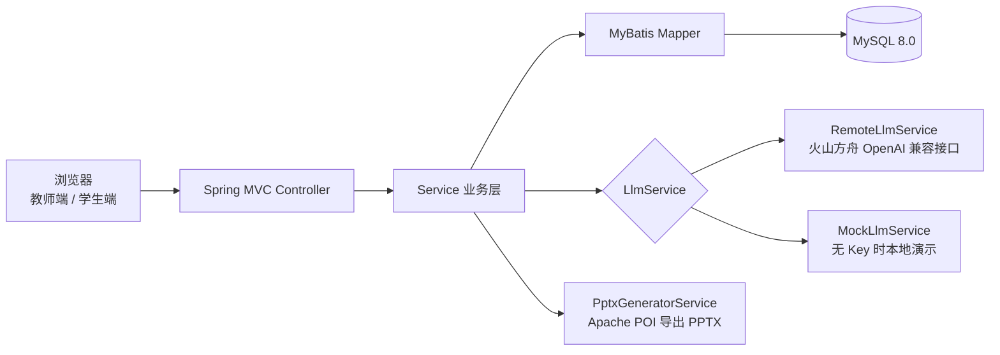

# 智绘课成

> 基于大模型的课件生成与教学管理平台

“智绘课成”是一个面向高校课堂的 AI 动画课件平台。教师输入知识点后，系统调用大模型生成可交互的动画课件，并完成课程归档、班级发布、作业批阅、成绩统计与教学反馈；学生可以在线学习动画、作答提交、查看成绩与错题回顾。

本项目为大连科技学院软件工程专业本科毕业设计作品。

## 目录

- [1. 项目简介](#1-项目简介)
- [2. 功能一览](#2-功能一览)
- [3. 技术栈](#3-技术栈)
- [4. 项目结构](#4-项目结构)
- [5. 快速开始](#5-快速开始)
- [6. 操作路径与页面跳转](#6-操作路径与页面跳转)
- [7. 核心业务规则](#7-核心业务规则)
- [8. 页面与接口](#8-页面与接口)
- [9. 数据库设计](#9-数据库设计)
- [10. 构建与部署](#10-构建与部署)
- [11. 常见问题](#11-常见问题)
- [12. 安全与提交说明](#12-安全与提交说明)
- [13. 作者](#13-作者)

---

## 1. 项目简介

传统课件制作需要教师投入大量时间做排版、绘图和动画。本项目把“知识点 → 动画课件 → 课堂任务 → 学生学习 → 作业批阅 → 成绩分析”串成一条完整链路：

1. 教师创建课程，输入知识点，调用大模型生成 HTML 动画课件；
2. 系统按知识点智能归入对应课程，也支持教师手动调整；
3. 教师把课件发布为班级任务，设置截止时间；
4. 学生在「我的任务」点「开始学习」，在同一全屏浮层里观看动画并完成作答；
5. 客观题自动判分，主观题由教师批阅，可打回重做或单独顺延补交；
6. 教师查看待批阅、已批阅、成绩排名、成绩分布和导出数据；
7. 学生查看成绩、错题回顾、教师评语，并提交课件评价或疑问。

### 系统架构



前端不依赖 Node.js 构建，所有页面都是 `src/main/resources/static` 下的静态 HTML/CSS/JS，由 Spring Boot 直接提供。

---

## 2. 功能一览

### 教师端

| 模块 | 主要能力 |
| --- | --- |
| 教学看板（我的课件顶部） | 待批阅、已批阅、已提交人次、平均成绩、发布任务、学生反馈等 KPI，点击卡片切到对应模块 |
| 课程管理 | 新建/编辑/删除课程；按课程归档课件；查看课程下课件清单 |
| 课件生成 | 输入知识点生成动画课件；查看生成结果；下载 PPTX；删除课件 |
| 我的课件 | 按学科分组、折叠展开、搜索筛选；预览、编辑、共享、删除 |
| 共享广场 | 发布/下架共享课件；浏览他人共享课件；一键复制使用 |
| 班级管理 | 新建/编辑/删除班级；添加、移除、转班学生；学生搜索 |
| 发布任务 | 按班级和课件发布任务；设置截止时间；支持全部班级逐班发布 |
| 批阅作业 | 待批阅/已批阅汇总；客观题自动判分；主观题评分；打回重做；单独顺延 |
| 催交提醒（批阅作业内） | 对未提交学生单个/批量催交；学生通知栏接收；重复催交去重 |
| 成绩单 | 按课程/任务筛选；排名、平均分、最高分、成绩分布；CSV 导出 |
| 学生反馈 | 按课程和课件筛选评价/疑问；查看反馈详情 |
| 通知中心 | 学生提交作业、学生反馈等事件通知；未读红点；全部已读 |
| 个人设置 | 修改姓名、手机号、邮箱、密码 |

### 学生端

| 模块 | 主要能力 |
| --- | --- |
| 通知 | 登录默认进入通知页，查看教师催交和系统提醒 |
| 我的任务 | 未完成/已完成筛选；按课程查看任务；倒计时；进入学习 |
| 动画学习 | 在「我的任务」点「开始学习」打开全屏浮层：左侧播放动画课件，右侧同时作答；停留期间每 15 秒累计学习时长 |
| 在线作答 | 客观题选择、主观题输入；提交后即时更新任务状态，浮层内切换为答题回顾 |
| 我的成绩 | 按课程筛选；查看总分、排名、教师评语；点成绩条在中间工作区下钻逐题作答与错题 |
| 我的收藏 | 在课件浮层或任务卡片点「☆」收藏；收藏列表集中展示，可取消收藏（收藏状态保存在本机浏览器，不写入服务端） |
| 我的反馈 | 对课件提交评价或疑问；按课程/课件筛选；编辑、删除本人反馈 |
| 个人资料 | 查看账号数据；修改姓名、手机号、邮箱、密码 |

---

## 3. 技术栈

| 层次 | 技术 |
| --- | --- |
| 后端框架 | Spring Boot 3.5.16 |
| 运行环境 | Java 17+ |
| 持久层 | MyBatis 3.0.3 + MySQL 8.0 |
| 会话与权限 | HttpSession + 登录拦截器；BCrypt 密码哈希 |
| 大模型 | 火山方舟 OpenAI 兼容 `chat/completions` 接口；无 Key 自动切换 Mock |
| PPTX 导出 | Apache POI 5.2.5 |
| 前端 | 原生 HTML5 / CSS3 / JavaScript；无独立打包步骤 |
| 构建 | Maven Wrapper（`mvnw` / `mvnw.cmd`） |

---

## 4. 项目结构

```text
online-course-ai/
├── src/main/java/com/example/onlinecourseai/
│   ├── common/          # 统一返回体、业务异常、全局异常处理
│   ├── config/          # 登录拦截器、Web 配置
│   ├── controller/      # 12 组 REST 接口
│   ├── dto/             # 接口出入参对象
│   ├── entity/          # 数据库实体
│   ├── mapper/          # MyBatis Mapper 接口
│   └── service/         # 业务接口与实现
├── src/main/resources/
│   ├── application.properties
│   └── static/
│       ├── index.html              # 登录/注册入口
│       ├── course-generate.html    # 教师端
│       ├── student.html            # 学生端
│       ├── profile.html            # 学生个人资料
│       ├── teacher-profile.html    # 教师个人设置
│       ├── favicon.png
│       ├── terra-nova-bg.mp4       # 首页浅色背景
│       ├── orange-flower-bg.mp4    # 首页深色背景
│       └── assets/gp3/             # 3D 书架课件封面 b01–b12
├── sql/
│   ├── create.sql                  # 16 张表的建库建表脚本
│   ├── demo-data.sql               # 演示数据（仅数据）
│   ├── 02_insert_students.sql      # 分批种子脚本（可选）
│   ├── 03_insert_tasks.sql
│   ├── 04_insert_grades.sql
│   ├── 05_insert_new_classes.sql
│   ├── 06_insert_test_accounts.sql
│   ├── courseware_share.sql
│   └── feedback_data.sql
├── pom.xml
├── mvnw
├── mvnw.cmd
└── README.md
```

> `sql/demo-data.sql` 是完整演示数据，适合直接导入空库；`02`–`06` 是开发过程中分批使用的种子脚本，只有在对应基础数据已存在时才建议执行。

---

## 5. 快速开始

代码托管在私有仓库，先配置 GitHub SSH Key，再克隆：

```bash
git clone git@github.com:12l3abc/zhihui-kecheng.git
cd zhihui-kecheng
```

### 5.1 环境要求

- JDK 17 或更高版本
- MySQL 8.0
- 现代浏览器（Chrome / Edge / Firefox）
- 可选：火山方舟 API Key（不配置时自动使用 Mock 演示课件）

检查环境：

```bash
java -version
mysql --version
```

### 5.2 初始化数据库

`create.sql` 会自动创建 `course_ai` 数据库和 16 张表。首次安装建议使用空库：

```bash
mysql -u root -p < sql/create.sql
mysql -u root -p --default-character-set=utf8mb4 course_ai < sql/demo-data.sql
```

Windows PowerShell 不支持 `<` 输入重定向，可使用：

```powershell
cmd /c "mysql -u root -p < sql\create.sql"
cmd /c "mysql -u root -p --default-character-set=utf8mb4 course_ai < sql\demo-data.sql"
```

如果只需要空库，不导入演示数据，执行第一条即可。

演示数据包含：

- 213 个用户（教师/学生）
- 8 个班级、9 门课程
- 31 个动画课件、35 个教学任务
- 作答记录、成绩、学习记录、反馈、共享与收藏数据

导入后可使用测试账号直接体验：

| 角色 | 用户名 | 密码 |
| --- | --- | --- |
| 教师 | `teacher_test` | `123456` |
| 学生 | `student_test` | `123456` |

### 5.3 修改数据库连接

编辑 `src/main/resources/application.properties`：

```properties
spring.datasource.url=jdbc:mysql://localhost:3306/course_ai?useSSL=false&serverTimezone=Asia/Shanghai&characterEncoding=utf8&allowPublicKeyRetrieval=true
spring.datasource.username=root
spring.datasource.password=123456
```

把用户名和密码改成自己 MySQL 实例的配置。数据库名保持 `course_ai`，或者同步修改建库脚本和连接串。

### 5.4 配置大模型（可选）

`llm.api-key` 不写死在源码里，通过环境变量注入：

```properties
llm.api-key=${LLM_API_KEY:}
llm.model=doubao-seed-2-1-pro-260628
```

PowerShell 临时设置：

```powershell
$env:LLM_API_KEY="你的火山方舟 API Key"
.\mvnw.cmd spring-boot:run
```

IntelliJ IDEA：在 `Run → Edit Configurations → Environment variables` 中添加 `LLM_API_KEY=你的 Key`。

不配置 Key 时，`pickLlm()` 会自动使用 `MockLlmService`，仍可完整演示“生成课件 → 发布任务 → 学生学习 → 批阅 → 成绩”的流程，只是课件内容是内置示例。

### 5.5 启动应用

```bash
# Windows
mvnw.cmd spring-boot:run

# macOS / Linux
./mvnw spring-boot:run
```

默认端口 `8080`，浏览器打开：

```text
http://localhost:8080
```

首页是登录/注册入口。教师登录后进入 `course-generate.html`，学生登录后进入 `student.html`。

### 5.6 打包运行

```bash
mvnw.cmd clean package -DskipTests
java -jar target/online-course-ai-0.0.1-SNAPSHOT.jar
```

指定端口：

```bash
java -jar target/online-course-ai-0.0.1-SNAPSHOT.jar --server.port=8081
```

---

## 6. 操作路径与页面跳转

> 这一节按真实点击顺序写，重点说明“点哪里、点完看到什么、地址栏会不会变”。教师端 `course-generate.html` 和学生端 `student.html` 都是单页应用：左侧导航只切换同一个 HTML 里的页内视图，浏览器地址栏保持为 `http://localhost:8080/course-generate.html` 或 `http://localhost:8080/student.html`，不会跳到新 URL；只有登录、个人设置/个人资料、退出登录会真正跳转页面。

### 6.0 页面与地址对照

| 页面 | 访问地址 | 进入方式 |
| --- | --- | --- |
| 介绍页/登录页 | `http://localhost:8080/` 或 `/index.html` | 启动服务后直接打开；未登录时访问受保护页面也会被拦回这里 |
| 教师工作台 | `/course-generate.html` | 教师身份登录成功后自动跳转 |
| 教师个人设置 | `/teacher-profile.html` | 教师端左下角「个人设置」 |
| 学生工作台 | `/student.html` | 学生身份登录成功后自动跳转 |
| 学生个人资料 | `/profile.html` | 学生端左下角「个人资料」 |
| 登录弹窗 | 仍在当前介绍页，地址不变 | 点页面右上角或首屏的「开始使用」 |

### 6.1 登录、注册与角色分流

1. 启动项目后，浏览器打开 `http://localhost:8080/`，进入介绍页。
2. 点页面右上角或首屏主按钮「开始使用」，当前页会弹出登录框，地址栏仍是 `http://localhost:8080/`。
3. 登录框顶部有「登录」「注册」两个标签，默认停在「登录」。
4. 在「登录」标签内：
   - 输入用户名、密码；
   - 在「教师 / 学生」单选里选择本次登录的身份；
   - 需要 7 天免登录时勾选「自动登录（7天内免登录）」；
   - 点「登录」。
5. 登录成功后页面真正跳转，而不是只换视图：
   - 选择「教师」→ 跳到 `/course-generate.html`；
   - 选择「学生」→ 跳到 `/student.html`。
6. 如果账号实际角色与所选身份不一致，后端会拒绝登录并提示，不会强行进入错误端。演示账号见 [5.3 演示数据](#53-演示数据推荐先导入)。
7. 首次使用没有账号时：
   1. 在同一个弹窗点顶部「注册」标签；
   2. 填写用户名、密码、手机号、邮箱；
   3. 选择「教师 / 学生」身份；
   4. 点「注册」；
   5. 提示「注册成功，请登录」后，切回「登录」标签，用刚注册的账号登录。

### 6.2 教师端逐项操作与跳转

教师端登录后，左侧导航从上到下依次是：课件生成、我的课件、共享广场、课程管理、班级管理、发布任务、批阅作业、成绩单、学生反馈、通知中心；左下角是「个人设置」和「退出登录」。

| 点击左侧导航 | 中间工作区变成 | 地址栏 | 备注 |
| --- | --- | --- | --- |
| 课件生成 | 知识点输入 + 3D 书架 + 生成工作台 | 不变 | 首次登录默认停在这里；生成成功后在当前页进入预览，不跳新页面 |
| 我的课件 | 按学科分组的课件卡片列表 | 不变 | 点卡片在当前页打开课件预览 |
| 共享广场 | 全校共享课件列表 | 不变 | 「查看」打开全屏浮层；「使用」复制副本并打开副本预览 |
| 课程管理 | 课程卡片列表 | 不变 | 「课件」打开课程课件清单弹窗；清单里「预览」会关弹窗并切到「我的课件」 |
| 班级管理 | 班级卡片列表 | 不变 | 「名单」打开班级学生管理弹窗 |
| 发布任务 | 未发布/已发布课件与任务列表 | 不变 | 点课件卡片先进入只读预览，再点「发布」开弹窗 |
| 批阅作业 | 待批阅/已批阅汇总 | 不变 | 两级下钻：先选课程，再选学生；批阅在弹窗里完成 |
| 成绩单 | 课程/任务筛选 + 统计 + 图表 + 名单 | 不变 | 选任务后出现「导出成绩」，导出 CSV 文件 |
| 学生反馈 | 按课程归类的评价与疑问 | 不变 | 可按类型、科目、班级筛选；教师只读 |
| 通知中心 | 作业提交/课件反馈通知列表 | 不变 | 点「查看」会跳到「批阅作业」或「学生反馈」视图 |

教师端刷新页面后，会回到上一次停留的视图（记录在浏览器 localStorage），但不会恢复正在查看的课件预览或弹窗；需要重新点对应卡片。要换模块，优先点左侧导航，不要依赖浏览器“后退”。

#### 6.2.1 课件生成：输入知识点 → 生成 → 预览

1. 点左侧「课件生成」。
2. 在知识点输入框输入主题，例如「实验室制取氧气（高锰酸钾法）」。
3. 点「生成课件」。按钮进入生成中状态，页面提示 AI 正在生成；此时地址栏不变。
4. 生成成功后，当前页直接进入课件预览工作台：左侧仍是导航，中间显示生成的动画课件，右侧显示课件信息/题目等内容，不会跳转到新的 HTML。
5. 在预览里可以缩放、全屏查看动画；点「下载 PPTX」会直接下载当前课件的 PPTX 文件，不跳页面。
6. 生成后的预览页没有删除按钮；需要删除时回到「我的课件」，点对应卡片上的「删除」，确认后从列表删除。若课件已被任务引用或正在共享，后端会拒绝删除并提示原因。
7. 如果生成失败，页面会提示失败原因，输入内容保留，可修改后再次点「生成课件」。

#### 6.2.2 我的课件：预览、编辑、共享、删除

1. 点左侧「我的课件」，中间工作区切换为按学科分组的课件卡片。
2. 顶部可按「全部 / 本月 / 共享中 / 未共享」筛选，也可用搜索框按标题搜索；这些操作都只刷新当前视图。
3. 点任意课件卡片，会在当前页打开该课件的预览，地址栏不变。预览中可缩放、全屏、下载 PPTX。
4. 卡片上的「编辑」会打开编辑弹窗，修改标题、知识点、简介等内容，点弹窗内「保存」后回到列表。
5. 卡片上的「发布共享」会打开共享弹窗，填写共享说明/选择科目后点「确认发布」；成功后卡片状态从「未共享」变为「共享中」。
6. 已共享的课件，按钮变为「取消共享」；点它会出现确认框，确认后从共享广场下架，但课件本身仍保留在「我的课件」。
7. 卡片上的「删除」会弹出确认框；确认后删除课件，取消则不变。
8. 顶部「+ 新建课件」会打开新建弹窗：输入知识点 → 点「开始生成」，生成过程在本页弹窗/工作台内完成，不跳新页面。

#### 6.2.3 共享广场：查看别人的课件、复制使用

1. 点左侧「共享广场」，中间显示全校教师共享的课件列表。
2. 点某条课件的「查看」，会打开全屏课件预览浮层；此时地址栏仍是 `course-generate.html`，关闭浮层就回到共享广场列表。
3. 点「使用」会先弹出确认框，说明将复制一份到「我的课件」；确认后系统复制副本，并直接打开这份副本的预览。原课件仍属于原作者，后续修改副本不会影响原课件。
4. 自己发布的共享课件会带「我发布的」标记；需要下架时回「我的课件」点「取消共享」，不是在共享广场里删除别人的课件。
5. 共享广场只负责浏览和复制，不会把课件直接变成自己的课程或任务；复制后还要到「课程管理」归科、到「发布任务」下发。

#### 6.2.4 课程管理：建课、智能归科、查看课程课件

1. 点左侧「课程管理」，进入课程卡片列表。
2. 点「+ 新建课程」，弹出「新建课程」弹窗：
   - 填课程名称（必填）；
   - 选填课程号、学分、学期、课程简介；
   - 点「保存」。保存成功后弹窗关闭，列表刷新，地址栏不变。
3. 点「✦ 智能归科」，系统读取你已有的全部课件，自动判断科目并建课；分析完成后弹出「智能归科结果」弹窗，展示判定依据和分组结果。
4. 智能归科结果弹窗里，每条课件右侧有「移动」：点它再弹出「移动课件」小窗，选目标课程（或「未归科（移出课程）」），点「移动」确认；完成后回到结果弹窗，可继续调整。
5. 课程卡片上的「课件」会打开该课程的课件清单弹窗，列出课程下的课件。
6. 在课件清单里点某条课件的「预览」，会关闭弹窗、自动切到「我的课件」视图，并打开这份课件的预览。也就是说：**点完之后左侧高亮会从「课程管理」变成「我的课件」，地址栏仍不变。**
7. 课程卡片上的「编辑」打开编辑课程弹窗；「删除」弹确认框。删除课程不会删除课件，只会解除课程与课件的归属关系。

#### 6.2.5 班级管理：建班、加学生、转班、移出

1. 点左侧「班级管理」，进入班级卡片列表。
2. 点「+ 新建班级」，弹出输入框，填班级名称后确认；成功后列表刷新，地址栏不变。
3. 班级卡片上的「名单」会打开班级学生管理弹窗，弹窗内可以：
   - 按学号/姓名/专业搜索；
   - 按性别、年级、专业筛选；
   - 点「+ 添加学生」把学生加入本班；
   - 点学生行「转班」选择目标班级；
   - 点「移出」把学生移出本班，历史成绩保留。
4. 班级卡片的「编辑」只改班级名称；「删除」会弹确认框，删除班级后学生历史成绩仍保留，但不再属于该班。
5. 这些操作都在弹窗内完成，关闭弹窗回到班级列表，不会跳新页面。

#### 6.2.6 发布任务：先预览，再选班级和截止时间

1. 点左侧「发布任务」，默认显示「未发布」的课件卡片，可按学科分组、搜索、按班级/课程筛选。
2. 点某张课件卡片，会进入只读预览页（仍在当前 HTML 内），顶部有「返回发布任务」；此时还没有发布，学生看不到任务。
3. 在预览页点「发布」，打开「发布任务」弹窗：
   - 勾选接收班级；勾选「全部班级」会逐班下发；
   - 设置截止时间；
   - 点「确认发布」。
4. 发布成功后弹窗关闭，该课件从「未发布」移到「已发布」，并生成对应的学生任务；地址栏不变。
5. 切到「已发布」标签，可查看已发布任务、截止时间、班级和提交情况；需要调整时在列表里进入对应任务处理。
6. 发布前务必确认课件内容：一旦发布，学生端「我的任务」会立即出现该任务，并开始按截止时间倒计时。

#### 6.2.7 批阅作业：待批阅 → 选课程 → 选学生 → 弹窗批阅

1. 点左侧「批阅作业」，顶部有「待批阅」和「已批阅」两个汇总入口。
2. 在「待批阅」下：
   - 先选一门课程，页面内展开该课程下有待批作业的任务/课件列表；
   - 点具体任务，进入学生提交列表；
   - 点某位学生的「去批阅」，打开批阅弹窗。
3. 批阅弹窗内：
   - 客观题由系统自动判分，教师主要批改主观题；
   - 主观题分数不能超过该题满分；
   - 可查看/修改学生答案后回写；
   - 点「提交成绩」完成批阅（重新批阅时按钮为「更新成绩」；还有下一位待批学生时可点「保存并下一位」），弹窗关闭，列表状态更新。
4. 需要让学生重做时，在弹窗或学生行点「打回重做」，可在打回时单独顺延该学生的补交截止时间。
5. 对未提交学生，可在任务提交列表点「催交」，系统给学生发通知；也可点「一键催交」批量提醒，或单独「顺延补交」调整截止时间。
6. 在「已批阅」下，先选课程，再看到已批学生列表；点「重新批阅」会重新打开批阅弹窗修改分数。
7. 所有批阅操作都在当前页的列表/弹窗内完成，地址栏保持 `course-generate.html`。

#### 6.2.8 成绩单：选课程/任务 → 看统计 → 导出

1. 点左侧「成绩单」，进入成绩统计页。
2. 先在课程下拉选课程（默认「全部课程」），再在任务下拉选具体任务；不选任务时名单区提示「请先选择一个任务」。
3. 选任务后，页内出现：
   - 平均分、最高/最低分、提交率、满分参考等统计卡；
   - 分数段/提交情况图表；
   - 已提交和未提交学生名单。
4. 名单有数据时，右上出现「导出成绩」；点它会下载当前任务的 CSV 成绩文件，不跳新页面。
5. 换课程会重置任务下拉并重新加载；换任务只刷新统计和名单，地址栏不变。
6. 成绩单是只读统计，不在这里改分；要改主观题分数回「批阅作业」。

#### 6.2.9 学生反馈：按课程查看评价与疑问

1. 点左侧「学生反馈」，进入反馈汇总页。
2. 顶部可按「全部类型 / 仅评价 / 仅疑问」、科目、班级筛选；筛选只刷新当前列表。
3. 反馈按课程分组展示，课程标题下列出该课程下学生提交的评价/疑问、提交人和时间。
4. 教师只能查看自己名下课程/课件的反馈，不能修改或删除学生反馈；需要回复或处理时，线下沟通或让学生本人在学生端「我的反馈」里编辑。
5. 点「通知中心」里课件反馈类通知的「查看」，会直接切到这个视图，而不是打开新页面。

#### 6.2.10 通知中心：看通知、跳转处理、标已读

1. 点左侧「通知中心」，进入通知列表；左侧导航「通知中心」上的红点表示未读数量。
2. 每条通知分两类：
   - 「作业提交」：点「查看」会切到「批阅作业」视图；
   - 「课件反馈」：点「查看」会切到「学生反馈」视图。
3. 点「标为已读」只把该条标为已读并刷新红点；点右上「全部标为已读」批量处理。
4. 通知的「查看」只切换页内视图，不跳新 URL；处理完用左侧导航回其他模块。

#### 6.2.11 个人设置与退出登录

1. 点左下角「个人设置」，会真正跳转到 `/teacher-profile.html`，可维护姓名、联系方式、头像等个人资料。
2. 在个人设置页点返回工作台，回到 `/course-generate.html`。
3. 点左下角「退出登录」，弹出确认框；确认后清空登录状态并跳转 `/index.html`，取消则留在当前页。

### 6.3 学生端逐项操作与跳转

学生端登录后，左侧导航从上到下是：通知、我的任务、我的收藏、我的成绩、我的反馈；左下角是「个人资料」和「退出登录」。学生端默认进入「通知」，刷新页面也会回到「通知」。

| 点击左侧导航 | 中间工作区变成 | 地址栏 | 备注 |
| --- | --- | --- | --- |
| 通知 | 教师催交/系统通知列表 | 不变 | 登录默认页；点「去完成」切到「我的任务」，不自动打开任务 |
| 我的任务 | 按课程分组的任务卡片 | 不变 | 点「开始学习/查看回顾」打开全屏作答浮层 |
| 我的收藏 | 本机收藏的课件列表 | 不变 | 收藏存 localStorage；换浏览器/清缓存会丢失 |
| 我的成绩 | 按科目筛选的成绩列表 | 不变 | 点成绩条在中间工作区下钻答题详情 |
| 我的反馈 | 本人提交的评价/疑问 | 不变 | 编辑、删除在页内弹窗完成 |
| 个人资料 | 跳转 `/profile.html` | 变成 `/profile.html` | 真正换页面 |
| 退出登录 | 确认后跳 `/index.html` | 变成 `/index.html` | 真正换页面 |

#### 6.3.1 通知：从催交通知回到任务

1. 学生登录后默认落在「通知」视图。
2. 通知卡片显示任务标题、催交说明、时间；未读通知左侧有未读圆点。
3. 点某条通知右下角「去完成」，页面会切到「我的任务」视图，但**不会自动打开对应任务**；还需要在任务列表里找到该任务并点「开始学习」。
4. 通知读取状态由后端记录；教师再次催交会产生新通知。
5. 没有通知时显示「暂无通知」，不会跳转其他页面。

#### 6.3.2 我的任务：筛选 → 选任务 → 打开全屏学习浮层

1. 点左侧「我的任务」，进入按课程分组的任务卡片列表。
2. 顶部可切换「全部 / 未完成 / 已完成」，也可按课程/关键词筛选；筛选只改变当前列表。
3. 点任务卡片，右侧详情区显示该任务信息、截止时间、倒计时和按钮。
4. 点「开始学习」：
   - 如果该课件有对应作业任务，会打开全屏浮层（overlay），地址栏仍是 `student.html`；
   - 浮层左侧是动画课件 iframe，可放大、缩小、重置、全屏；
   - 浮层右侧是在线作答区，可做单选题、填空题、简答题；
   - 浮层打开期间，前端每 15 秒上报一次学习心跳，累计有效学习时长。
5. 如果该课件没有对应任务，点「查看动画」只打开课件预览浮层，右侧提示「课件预览仅供观看」，不出现提交按钮。
6. 在作答区至少答一题后点「提交作答」：
   - 客观题自动判分，主观题等待教师批阅；
   - 提交成功后浮层内切换为答题回顾，显示客观题得分和参考答案；
   - 任务卡片即时从「未完成」移到「已完成」，不需要手动刷新。
7. 点浮层左上角「返回」关闭浮层，回到任务列表；已提交的任务按钮变为「查看回顾」，可再次打开浮层查看答题情况。
8. 任务已关闭或已过截止时间时，卡片会提示不可提交，浮层内提交按钮也会被锁定；此时需要联系教师顺延补交时间。

#### 6.3.3 我的收藏：本机收藏与取消

1. 点左侧「我的收藏」，中间显示已收藏课件。
2. 收藏入口有两个：
   - 在任务卡片或右侧课件详情点收藏按钮（星形图标，未收藏显示「收藏」，已收藏显示「已收藏」）；
   - 在课件预览浮层里点收藏按钮。
3. 收藏后左侧「我的收藏」计数增加；再点一次同一个按钮取消收藏。
4. 收藏数据保存在当前浏览器的 localStorage，不写服务端；换电脑、换浏览器或清理浏览器缓存后收藏会消失。
5. 点收藏卡片会打开课件预览浮层；收藏不等于选课，也不影响教师发布的任务。

#### 6.3.4 我的成绩：筛选 → 点成绩条 → 工作区下钻

1. 点左侧「我的成绩」，进入成绩页。
2. 顶部可按科目筛选；切换后只刷新当前成绩列表。
3. 点某条成绩记录/成绩条，中间工作区会下钻到该次作业的答题详情，显示得分、用时、逐题作答和错题；地址栏不变。
4. 下钻后右侧栏切换为本次答题统计面板；点详情区「返回」回到成绩概览。
5. 成绩页是只读的，不能修改答案；需要查看原始作答可在「我的任务 → 查看回顾」重新打开浮层。

#### 6.3.5 我的反馈：查看、编辑、删除本人反馈

1. 点左侧「我的反馈」，进入本人反馈列表。
2. 可按反馈类型（评价/疑问）和课件筛选；筛选只刷新列表。
3. 点某条反馈可查看完整内容、提交时间、对应课件。
4. 点「编辑」打开页内弹窗，修改内容后保存；点「删除」弹确认框，确认后删除。两者都不跳新页面。
5. 新反馈也可以在学习浮层右侧「课件评价与疑问」里直接提交：选择「发表评价/提出疑问」→ 输入内容 → 点「提交」。
6. 教师端只能查看反馈，不能代替学生修改或删除；需要改内容时由学生本人在此页操作。

#### 6.3.6 个人资料与退出登录

1. 点左下角「个人资料」，真正跳转到 `/profile.html`，可维护姓名、学号、专业、年级、联系方式等。
2. 在个人资料页返回学生工作台，回到 `/student.html`。
3. 点「退出登录」，弹确认框；确认后跳 `/index.html`，取消留在当前页。

### 6.4 使用说明与常见误区

- **左侧导航不是新页面。** 教师端 `switchView()`、学生端 `switchTab()` 都只替换中间工作区；看到地址栏没变是正常的，不要以为点击失败。
- **浏览器“后退”不会退回上一个模块。** 因为模块切换没有产生历史记录，后退可能直接退出工作台；要换模块请点左侧导航。
- **刷新会丢临时界面。** 教师端刷新回到上次视图，但预览、弹窗、共享广场浮层会关闭；学生端刷新固定回「通知」，正在作答的浮层会关闭。作答中途不要刷新。
- **教师端“课程管理 → 课件 → 预览”会换视图。** 点完后左侧高亮变为「我的课件」，这是设计好的跳转，不是弹窗没关干净。
- **共享广场的「使用」是复制，不是引用。** 复制后的副本独立存在，原作者的后续修改不会同步过来。
- **学生收藏只在本机。** 换设备后收藏列表为空，教师端也看不到学生的本地收藏。
- **提交前确认截止时间。** 已截止/已关闭任务不能提交；倒计时以服务端任务截止时间为准。
- **演示账号与真实账号分开。** 演示数据中的 `teacher_test` / `student_test` 仅用于验收流程，正式使用请注册自己的账号。

---

## 7. 核心业务规则

1. **一课件一班一任务**：`task` 表对 `(class_id, animation_id)` 建唯一索引，同一班级不能重复发布同一课件。
2. **截止后禁止提交**：任务关闭或超过截止时间后，学生不能新进入作答或提交；教师可对个别学生单独顺延补交。
3. **打回重做**：教师打回后，学生需要重新提交；可同时设置该生的补交截止时间，不影响全班。
4. **催交去重**：同一教师对同一任务、同一学生重复催交时，只保留最新一条有效提醒，学生通知栏不重复堆积。
5. **排名口径**：排名、平均分、最高分、成绩分布只统计 `GRADED`；`REVIEWING` 不计入。
6. **学习时长**：由服务端心跳累计，前端只负责触发；历史任务不回填旧学习秒数，新进入任务后开始累计。
7. **智能归科**：只处理 `course_id IS NULL` 的课件，不覆盖教师手工归课。
8. **反馈可见性**：学生只能查看/编辑/删除自己的反馈；教师只能查看与自己课件相关的反馈。
9. **共享独立性**：共享广场的上下架状态与课件本身的状态解耦，取消共享不会删除课件。
10. **登录身份校验**：登录时选择的“教师/学生”身份必须与账号实际角色一致。

---

## 8. 页面与接口

### 页面

| 页面 | 路径 | 说明 |
| --- | --- | --- |
| 登录/注册 | `/` 或 `/index.html` | 角色选择、登录、注册 |
| 教师端 | `/course-generate.html` | 教师全部教学功能 |
| 学生端 | `/student.html` | 学生任务、学习、成绩、反馈 |
| 学生个人资料 | `/profile.html` | 学生账号信息与密码 |
| 教师个人设置 | `/teacher-profile.html` | 教师账号信息与密码 |

### 接口分组

所有接口统一返回：

```json
{ "code": 200, "message": "success", "data": ... }
```

未登录访问 `/api/**` 返回 `401`，前端跳转登录页。

| 前缀 | 职责 |
| --- | --- |
| `/api/auth` | 注册、登录、退出、当前用户、资料、密码 |
| `/api/ai` | 生成课件、我的课件、详情、摘要、更新、答题、删除、PPTX 下载 |
| `/api/courses` | 课程增删改查、搜索、智能归科、课程课件、移动课件 |
| `/api/classes` | 班级增删改查、学生增删、转班、搜索、合并 |
| `/api/tasks` | 发布/更新/删除/开关任务、搜索、我的任务、学习心跳、任务详情 |
| `/api/tasks/{id}/...` | 提交、我的作答、批阅、打回、顺延、催交、通知 |
| `/api/grades` | 我的成绩、任务排名、成绩分析 |
| `/api/feedback` | 提交反馈、按课件查询、我的反馈、教师反馈、编辑、删除 |
| `/api/share` | 发布/下架共享、我的共享、广场、收藏、使用共享课件 |
| `/api/student` | 学生课件分组 |
| `/api/notify` | 我的通知、单条已读、全部已读 |
| `/api/teacher` | 教师工作台看板 |

---

## 9. 数据库设计

数据库：`course_ai`，字符集 `utf8mb4`。

| 表 | 说明 |
| --- | --- |
| `sys_user` | 教师/学生账号，含姓名、手机号、邮箱、性别、年级、专业 |
| `class_info` | 班级，关联创建教师 |
| `enrollment` | 学生-班级多对多选课关系 |
| `course` | 教师课程，含课程名称、代码、学分、学期 |
| `animation` | 课件，保存大模型生成的 HTML、摘要、状态、归属课程 |
| `task` | 教学任务，关联班级和课件，含截止时间与状态 |
| `question` | 课件配套题目，含客观题选项、答案、类型、分值 |
| `answer_record` | 学生逐题作答记录 |
| `grade` | 每任务每学生一条成绩汇总，含主观分、评语、批阅状态 |
| `task_study_record` | 学习记录，含有效学习秒数、确认状态、首次打开/确认时间 |
| `courseware_feedback` | 学生对课件的评价与疑问 |
| `courseware_share` | 课件共享记录，含学科、说明、浏览/收藏数、上下架状态 |
| `courseware_favorite` | 教师收藏共享课件 |
| `task_submit_extension` | 教师给单个学生顺延的补交截止时间 |
| `task_remind` | 教师催交提醒 |
| `teacher_notification` | 教师通知，含作业提交和课件反馈事件 |

建表脚本：`sql/create.sql`。演示数据：`sql/demo-data.sql`。

---

## 10. 构建与部署

### 本地构建

```bash
mvnw.cmd clean package -DskipTests
```

产物：

```text
target/online-course-ai-0.0.1-SNAPSHOT.jar
```

当前版本 jar 约 70 MB，已包含前端静态资源（含两段首页背景视频）。

### 服务器部署

1. 安装 JDK 17+ 和 MySQL 8.0；
2. 导入 `sql/create.sql` 和 `sql/demo-data.sql`；
3. 修改 `application.properties` 的数据库连接；
4. 通过环境变量设置 `LLM_API_KEY`（可选）；
5. 启动：

```bash
java -jar online-course-ai-0.0.1-SNAPSHOT.jar --server.port=8080
```

生产环境建议：

- 使用 Nginx 反向代理并配置 HTTPS；
- 不要把数据库账号、API Key 写进代码或提交到仓库；
- 定期备份 `course_ai` 数据库；
- 为 MySQL 创建独立应用账号，不使用 root。

---

## 11. 常见问题

### Q1：启动报 `Unknown database 'course_ai'`

没有执行建库脚本。先执行：

```bash
mysql -u root -p < sql/create.sql
```

### Q2：启动报 `Table 'course_ai.course' doesn't exist`

使用了旧版建表脚本。请使用本仓库最新的 `sql/create.sql`，其中已包含 `course` 表。

### Q3：登录后接口返回 401

接口依赖 HttpSession。请确认：

- 浏览器允许 Cookie；
- 前后端使用同一个地址和端口访问；
- 先调用 `/api/auth/login` 登录，再访问业务接口。

### Q4：生成课件一直返回示例内容

没有配置大模型 Key，系统自动使用 `MockLlmService`。设置环境变量：

```powershell
$env:LLM_API_KEY="你的火山方舟 API Key"
```

然后重启应用。

### Q5：发布任务提示“该班级已发布过这份课件”

这是业务拦截：同一班级和同一课件只能有一个任务。请换班级或换课件；如果确实需要重发，先删除原任务。

### Q6：学生看不到任务

检查：

- 学生是否已加入该班级（`enrollment`）；
- 任务是否是 `ACTIVE`；
- 是否已过截止时间；
- 教师是否把任务发布到了该学生所在班级。

### Q7：中文显示乱码

确认数据库、连接串和导入命令都使用 `utf8mb4`：

```bash
mysql -u root -p --default-character-set=utf8mb4 course_ai < sql/demo-data.sql
```

### Q8：8080 端口被占用

```bash
java -jar target/online-course-ai-0.0.1-SNAPSHOT.jar --server.port=8081
```

---

## 12. 安全与提交说明

- 仓库不包含真实大模型 API Key，密钥通过 `LLM_API_KEY` 环境变量注入。
- `application.properties` 中的数据库密码是本地演示默认值，部署时必须修改。
- `sql/demo-data.sql` 中的学生姓名、手机号、邮箱均为演示数据，仅用于课程展示。
- 本仓库默认私有，答辩结束前不建议直接公开；如需公开，请先清理演示数据和本地配置。
- 提交前请确认 `target/`、`.idea/`、运行日志、截图和数据库备份没有被加入版本控制。

---

## 13. 作者

- 作者：刘淑函
- 学校：大连科技学院
- 专业：软件工程
- 届别：2027 届
- 项目：基于大模型的课件生成与教学管理平台（智绘课成）

本项目为本科毕业设计作品，暂未声明开源许可证。未经作者许可，请勿用于商业用途或二次分发。
