# 智绘课成 · 使用说明

这份说明按真实界面编写，面向第一次使用平台的老师和评审。每一步都写清楚：**点哪里、点击后进入哪个页面、页面上能做什么**。截图取自导入演示数据后的实际运行界面，按钮名称与页面布局均与当前版本一致。

先记住三条规则，后面的操作会更容易理解：

1. **教师端的大部分栏目都在同一个工作台页面内切换。** 点左侧“我的课件”“课程管理”“批阅作业”等，内容会替换，但浏览器地址不变；只有“个人设置”会进入独立页面。
2. **学生端也一样。** 左侧“通知”“我的任务”“我的成绩”等在同一学生页面内切换；只有“个人资料”会进入独立页面。
3. **看左上角判断身份。** 教师端显示“Teacher · 教师端”，学生端显示“Student · 学生端”。如果进错了端，先退出登录，再在登录弹窗里切换身份。

## 一、演示账号与进入方式

演示环境使用下面两组账号。教师和学生必须分别登录，不能在同一账号里切换角色。

| 身份 | 用户名 | 密码 | 登录后首先看到的页面 |
| --- | --- | --- | --- |
| 教师 | teacher_test | 123456 | 课件生成首页（3D 书架） |
| 学生 | student_test | 123456 | 通知 |

在浏览器打开平台登录页，点右上角“登录”，页面中央会弹出登录框。

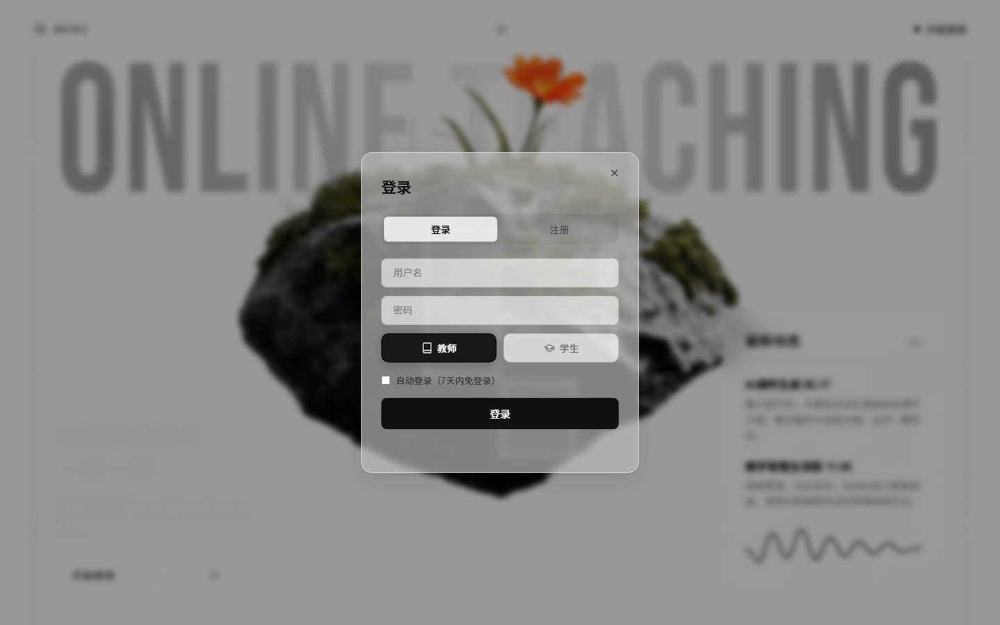

*图 1　登录弹窗：上方是“登录 / 注册”，下方是身份切换、账号密码和自动登录*

登录步骤：

1. 在弹窗顶部确认停留在“登录”标签。
2. 输入用户名和密码。
3. 在账号框下方选择“教师”或“学生”。**身份必须和账号匹配**，教师账号选“学生”不会进入学生端。
4. 需要下次免登录时，勾选“自动登录（7 天内免登录）”；在公用电脑上建议不勾选。
5. 点最下方的黑色“登录”按钮。

点击后：

- 选“教师”登录成功 → 进入**课件生成首页**，先看到 3D 书架。
- 选“学生”登录成功 → 进入**通知**页，左侧导航默认停在“通知”。

> 如果登录后左上角身份不对，或页面提示账号不存在，先点左下角“退出登录”，回到登录页重新选择身份。

## 二、页面去向速查

下面这张表回答最常见的问题：“点这个按钮，到底会去哪里？”

| 你点击的位置 | 点击后到达 | 怎么回来 |
| --- | --- | --- |
| 登录弹窗“登录”（教师身份） | 教师端课件生成首页，3D 书架 | 点左下角“退出登录”回登录页 |
| 登录弹窗“登录”（学生身份） | 学生端通知页 | 点左下角“退出登录”回登录页 |
| 教师端左侧“个人设置” | 独立的教师个人设置页 | 点右上角“返回工作台” |
| 教师端 3D 书架右上“我的课件” | 我的课件列表 | 点左侧“课件生成”回书架 |
| 教师端 3D 书架右上“返回工作台” | 三栏课件工作台，书架收起 | 点左侧“课件生成”重新打开书架 |
| 工作台右上“返回课程管理” | 课程管理 | 点左侧“课件生成”回首页 |
| 我的课件里点某张课件卡 | 该课件的三栏预览工作台 | 点“返回课程管理”，或点左侧其他栏目 |
| 教师端左侧“个人设置”以外的栏目 | 仍在教师工作台内，只替换主区域内容 | 点左侧任一栏目切换 |
| 学生端左侧“个人资料” | 独立的学生个人资料页 | 点右上角“返回学生端” |
| 学生端“我的任务”里点“开始学习” | 全屏动画学习页 + 右侧在线作答，仍在学生页内 | 点学习页顶部“返回”回任务列表 |
| 学生端左侧“个人资料”以外的栏目 | 仍在学生页内，只替换主区域内容 | 点左侧任一栏目切换 |

## 三、教师端操作

### 3.1 第一次进入：3D 书架首页

教师登录成功后，首先看到的是课件生成首页。它不是普通列表，而是一面可以操作的 3D 书架：课件封面悬浮在画面中，底部有知识点输入框，右上角有“我的课件”和“返回工作台”。

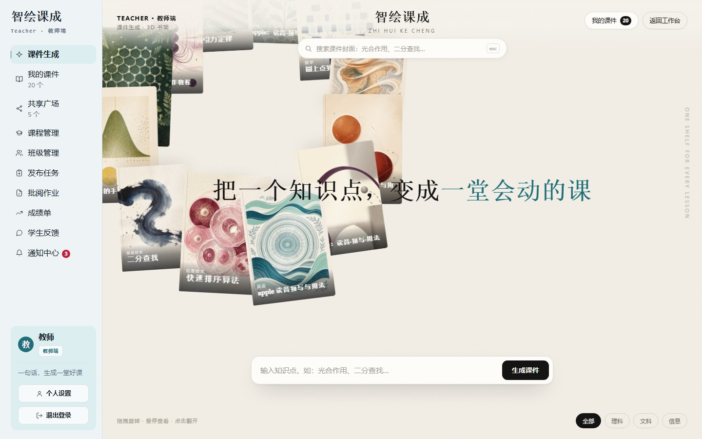

*图 2　教师端首页：上方搜索、右侧入口，中间是可用鼠标拖拽的 3D 书架*

这个页面有四类操作：

1. **转动书架。** 在封面区域按住鼠标拖动，书架会跟着旋转；鼠标悬停在封面上，会显示课件标题。
2. **按学科筛选。** 右下角有“全部 / 理科 / 文科 / 信息”四个筛选按钮，点一下只留下对应学科。
3. **搜索已有课件。** 顶部搜索框输入课件封面上的标题或知识点，匹配的封面会留下。
4. **直接生成新课件。** 在底部输入框写一个知识点，例如“勾股定理”，点右侧“生成课件”。系统开始生成，完成后会在当前工作台打开课件预览。也可以点右上角“返回工作台”，先进入空白的三栏制作界面，再在右下角输入知识点生成。

书架上的封面可以点击翻开。想回到普通的三栏工作台，点右上角“返回工作台”；书架会收起，露出中间的动画画布、右侧的课件信息和底部的生成输入框。

### 3.2 生成结果与课件预览

生成完成，或从“我的课件”点开一张课件卡后，会进入三栏工作台。左边是导航，中间是动画画布，右边是这节课的标题、核心知识点、易错点和随堂练习。

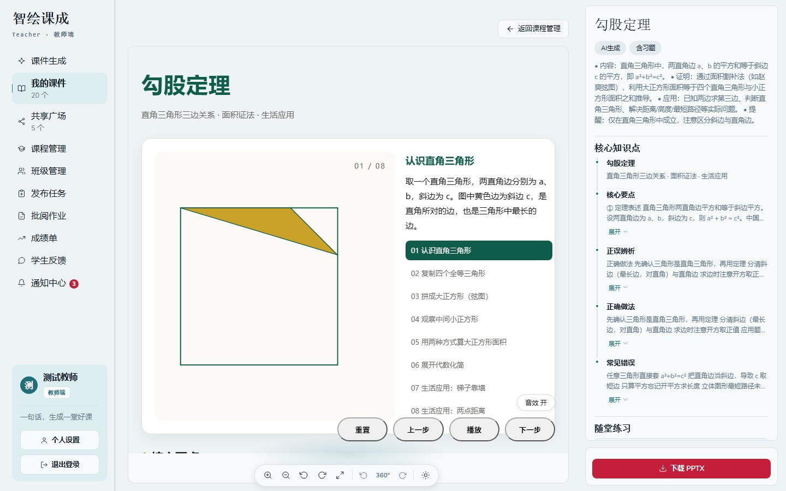

*图 3　课件预览：中间播放动画，右侧查看知识点，底部控制播放进度，右下角可下载 PPTX*

页面上的操作对应关系：

1. **中间画布**：显示当前课件的动画页面。画布下方有“重置 / 上一步 / 播放 / 下一步”，可以逐页讲解，也可以直接播放。
2. **画布右下角工具条**：放大、缩小、旋转、复位、全屏。讲课时点全屏，画布会铺满整个屏幕；按 Esc 退出全屏。
3. **右侧信息栏**：显示课件标题、AI 生成/含习题标签、内容摘要、核心知识点、易错点、随堂练习。带“展开”的条目可以点开查看完整说明。
4. **右下角“下载 PPTX”**：把当前课件导出为 PPTX 文件，用于线下授课或归档。
5. **右上角“返回课程管理”**：离开预览，进入课程管理页。

如果只是想把课件发给学生，不需要在这里找发布按钮。发布动作在左侧“发布任务”里完成。

### 3.3 我的课件：查找、预览、共享、删除

点左侧“我的课件”，进入课件列表。这里按学科分组，每组标题右侧显示课件数量，点分组标题可以折叠或展开。

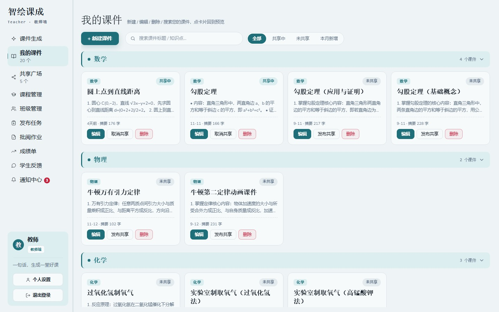

*图 4　我的课件：按学科分组，卡片可直接点开预览，底部是编辑、共享、删除操作*

操作步骤：

1. **找课件**：顶部搜索框输入标题或知识点；右侧“全部 / 共享中 / 未共享 / 本月新增”用于筛选共享状态和新增课件。
2. **看课件**：点卡片正文区域（不要点底部按钮），会进入该课件的三栏预览工作台。这是最常用的查看方式。
3. **改课件**：点卡片底部“编辑”，进入编辑状态调整内容。
4. **共享或取消共享**：点“发布共享”后，课件会出现在“共享广场”，其他教师可以看到并使用；已共享的课件按钮变为“取消共享”，点一下收回。
5. **删除课件**：点“删除”会移除这张课件。删除前先看清卡片标题，避免误删仍在授课的课件。

左上角“+ 新建课件”会进入课件制作流程，效果与首页底部输入知识点生成一致。

### 3.4 共享广场：看别人的课，或把别人的课拿来用

点左侧“共享广场”，进入教师之间的课件共享区。页面上方是统计卡，显示共享课件数、共享教师数、覆盖学科数；下方卡片按学科标色。

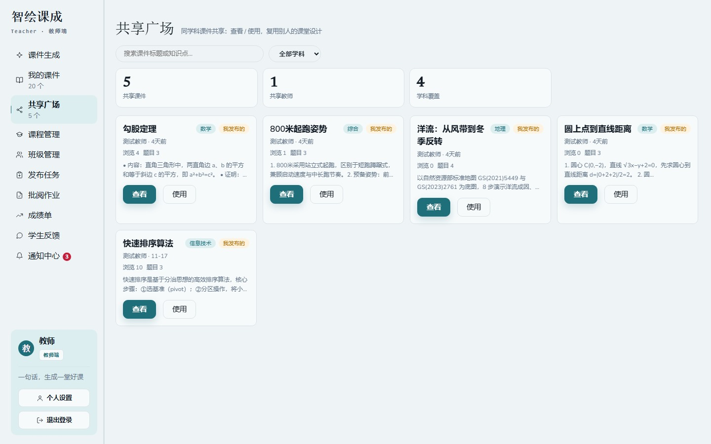

*图 5　共享广场：每张卡片都有“查看”和“使用”，右上角标出“我发布的”*

操作方式：

1. **先看效果**：点卡片底部“查看”，课件动画会铺满全屏播放。看完按 Esc 或页面上的退出全屏按钮返回。
2. **需要使用**：点“使用”，系统会弹出确认框。确认后会复制一份到你的“我的课件”，不会改动原作者的课件；之后可以继续编辑、发布或删除。
3. **识别来源**：卡片右上角有“我发布的”标签，表示这是你自己共享出去的课件；没有这个标签的是其他教师共享的。
4. **筛选**：顶部可以按课件标题、知识点搜索，也可以按“全部学科”切换学科。

### 3.5 课程管理：建课程、看课件清单

点左侧“课程管理”，进入课程卡片页。一位教师可以带多门课，每张卡片就是一门课程。

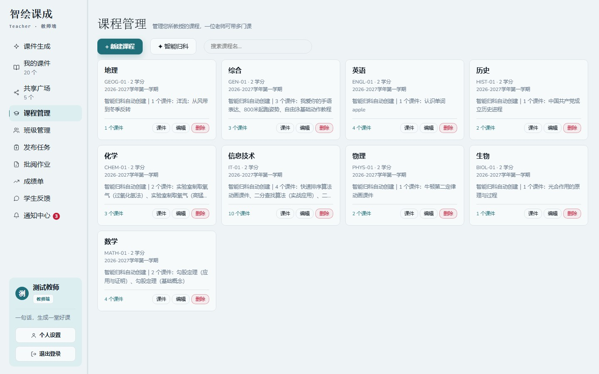

*图 6　课程管理：每张卡片显示课程号、学分、学期、课件数量和“课件 / 编辑 / 删除”*

页面顶部有三个入口：**+ 新建课程**、**智能归档**、**搜索课程名**。

#### 新建一门课程

1. 点左上角“+ 新建课程”，弹出“新建课程”窗口。
2. 填写“课程名称”，这是必填项，例如“Java 程序设计”。
3. 按需填写“课程号”“学分”“学期”“课程简介”。学分默认是 2，学期可以写“2026 秋”这类文本。
4. 点右下角“保存”。窗口关闭，新课程卡片出现在列表中。

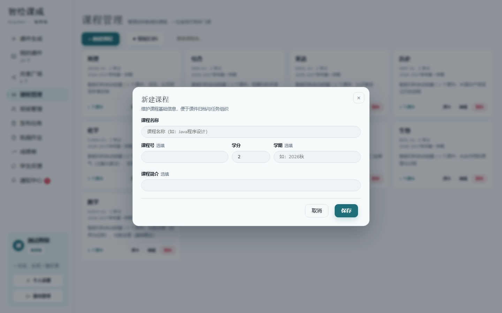

*图 7　新建课程：只有课程名称必填，其余字段可以留空*

#### 查看某门课的课件

1. 找到对应课程卡片。
2. 点卡片底部的“课件”按钮，弹出该课程的课件清单。
3. 在清单里查看课件标题、学科和数量；需要预览时点清单中的课件。
4. 关闭清单，回到课程管理。

卡片底部另外两个按钮：

- **编辑**：修改课程名称、课程号、学分、学期、简介。
- **删除**：删除这门课程。删除前先确认课程内的课件是否还需要保留。

### 3.6 班级管理：建班、看名单、加人、转班、移出

点左侧“班级管理”，进入班级卡片页。每张卡片显示班级名称、加入日期和学生人数，底部是“名单 / 编辑 / 删除”。

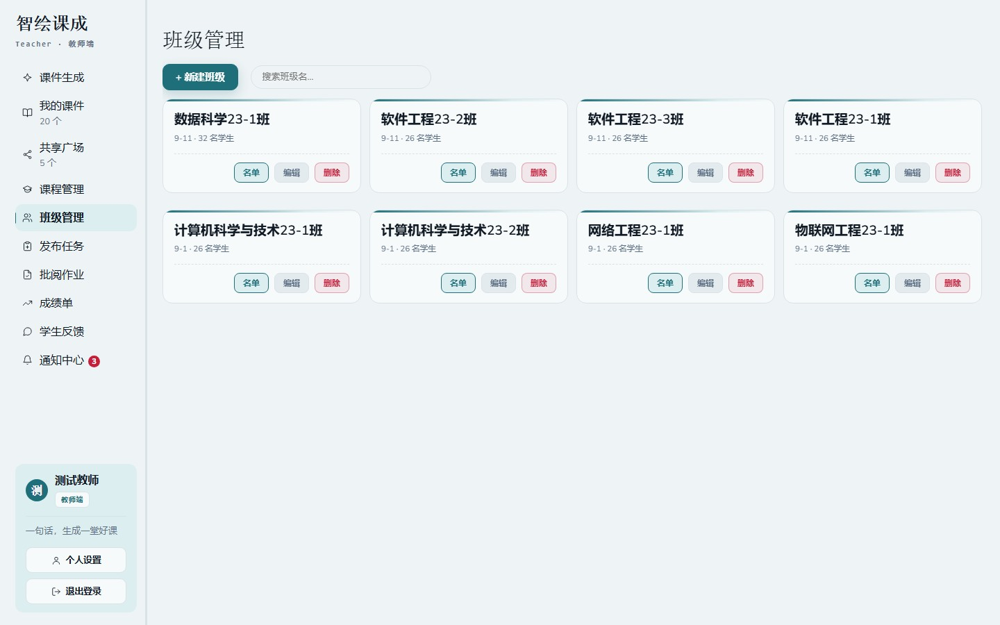

*图 8　班级管理：上方可新建班级或搜索，卡片底部管理名单*

操作步骤：

1. **新建班级**：点左上角“+ 新建班级”，按弹窗填写班级信息后保存。
2. **找班级**：在“搜索班级名”输入关键词，列表即时过滤。
3. **看名单**：点某张卡片的“名单”，弹出该班学生表。弹窗顶部显示班级名称和总人数。
4. **筛选学生**：名单上方有搜索框和“全部性别 / 全部年级 / 全部专业”三个下拉框，可以组合筛选。
5. **加学生**：点“+ 添加学生”，按弹窗选择或录入学生，确认后加入班级。
6. **转班**：在学生行右侧点“转班”，选择目标班级，确认后该生从当前班移出、进入新班。
7. **移出**：点“移出”，把学生从当前班级移除。这个动作会改变学生归属，操作前核对姓名和学号。
8. **编辑班级**：卡片底部“编辑”修改班级名称等信息；“删除”删除整个班级，删除前先处理班内学生。

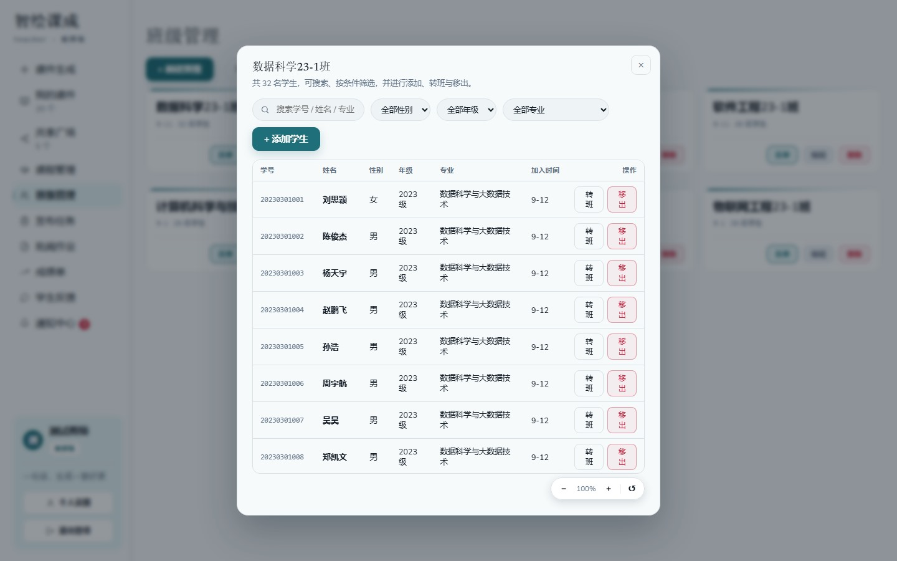

*图 9　班级名单：支持按姓名/学号/专业搜索，按性别、年级、专业筛选，逐行转班或移出*

### 3.7 发布任务：把课件发给班级

点左侧“发布任务”，进入待发布课件列表。页面按学科分组，顶部可搜索，右侧有“全部 / 未发布 / 已发布”三个筛选。

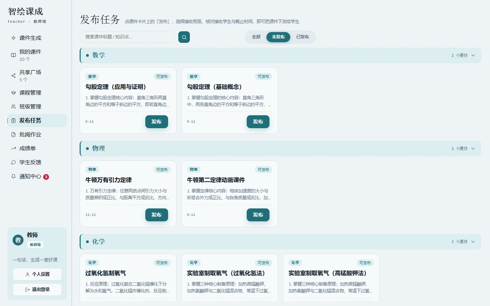

*图 10　发布任务：卡片上直接点“发布”，已发布的课件可在“已发布”里查*

操作步骤：

1. 在“未发布”里找到要下发的课件。卡片上会显示学科、标题、内容摘要和日期。
2. 想先确认内容，点卡片正文区域，会打开课件预览；看完关闭预览，回到列表。
3. 点卡片右下角“发布”，弹出“发布课件”窗口。
4. 检查“任务标题”，默认取课件标题，可以按本次作业改名。
5. 在“接收班级”下拉框选择目标班级。可以选一个班，也可以选“全部班级”；选择后，下方会列出将收到这份课件的学生名单。
6. “截止时间”可选。填写后学生端会显示倒计时；留空表示不设截止时间。
7. 点“确认发布”。窗口关闭，任务进入“已发布”，学生端“我的任务”里出现这张课件卡。

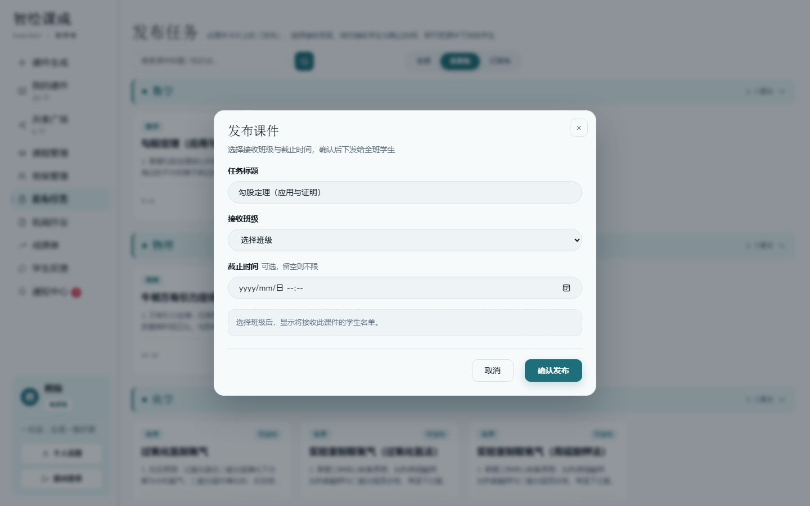

*图 11　发布课件：任务标题、接收班级、可选截止时间，选班后显示接收学生*

发布后的检查路径：左侧“发布任务” → 切到“已发布” → 找到刚发布的课件；再到“批阅作业”查看提交情况。

### 3.8 批阅作业：从待批到学生作答详情

点左侧“批阅作业”，先看到统计区：待批阅、已批阅、已提交人次、平均成绩、发布任务数、学生反馈数。统计区下方是“待批阅 · 选择科目”。

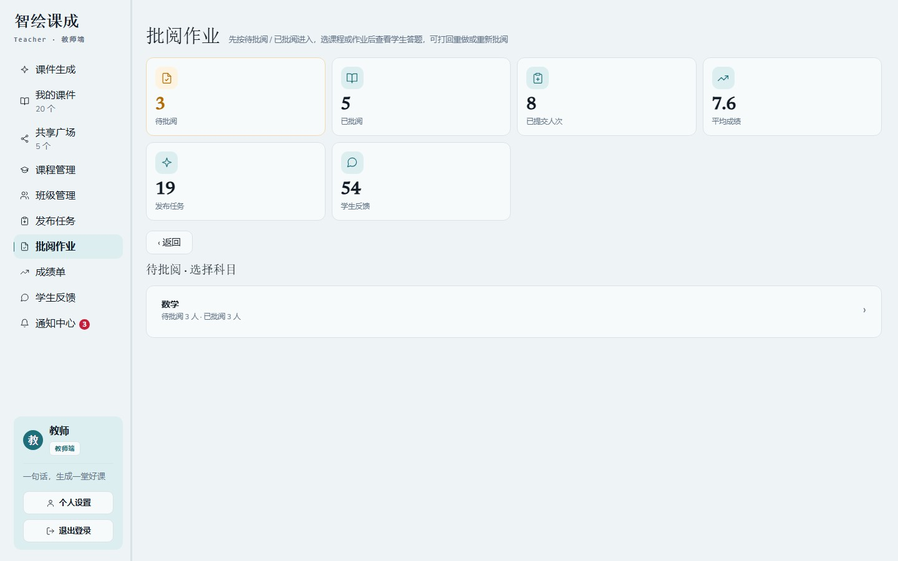

*图 12　批阅作业：先看统计，再点“数学”这类科目进入待批名单*

操作步骤：

1. 点某个科目，例如“数学”，进入该科待批阅列表。
2. 页面分成“待批阅”和“已批阅”两块。待批阅里每位学生显示任务名、班级、客观题得分和学号。
3. 点学生行右侧“去批阅”，打开“作答详情”弹窗。
4. 弹窗里逐题显示题干、选项、学生选择和得分。客观题会标出“答对 +10 分”；主观题在下方文本框里显示学生答案，教师可以直接修改答案文本。
5. 底部四个操作按用途区分：
   - **保存并下一位**：保存当前学生的批阅结果，直接打开下一位待批学生。只有后面还有待批学生时才显示。
   - **打回重做**：打开确认窗口，清空该生本次作答记录和已给成绩，并可为该生单独设置补交截止；留空则只打回、不顺延，不影响全班截止时间。
   - **提交成绩**：确认本次批阅结果，成绩进入成绩单。重新批阅时，按钮会变成“更新成绩”。
   - **关闭**：收起弹窗，回到学生名单；本次未提交的修改不会保存。

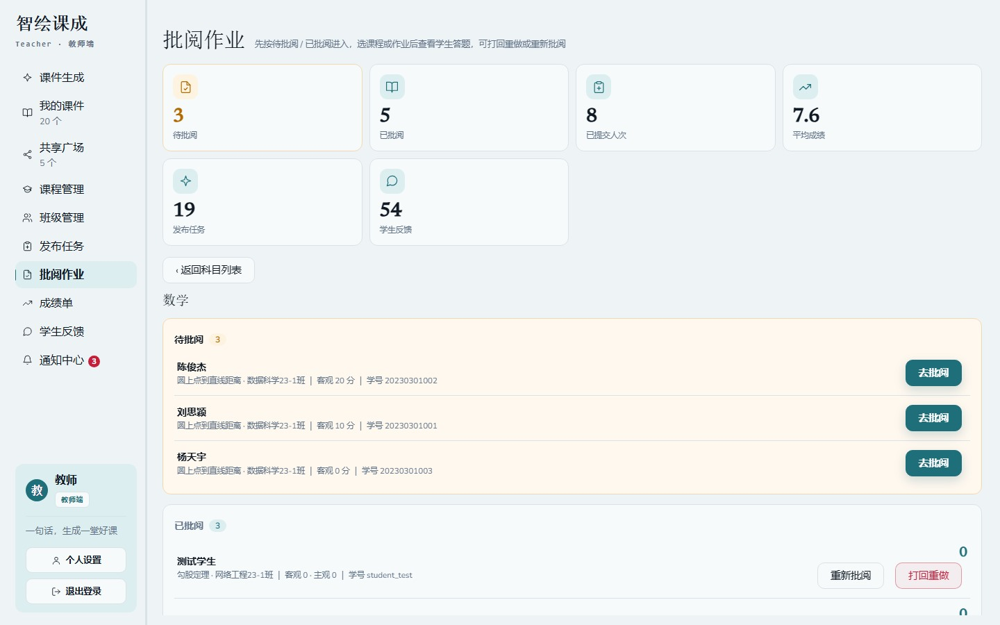

*图 13　科目内的待批名单：每位学生一行，右侧“去批阅”进入作答详情*

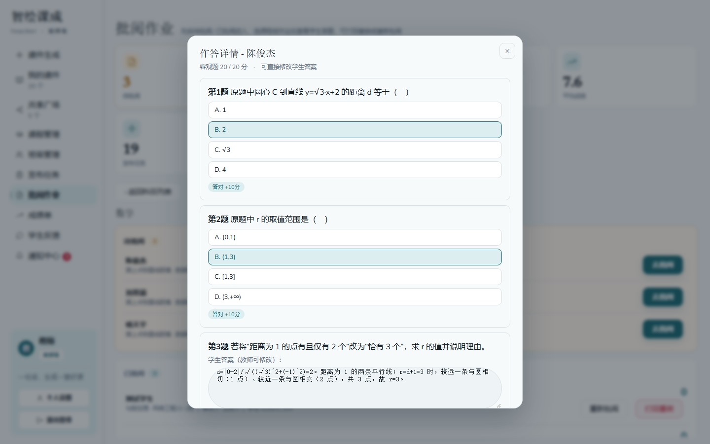

*图 14　作答详情：逐题查看和修改，顶部标明客观题得分，底部完成批阅动作*

已批阅的学生在列表下方，可点“重新批阅”再次打开详情；需要退回时点“打回重做”。批阅完成后，点页面上方“返回科目列表”或“返回”逐级退回统计页。

### 3.9 成绩单：按课程和任务看班级表现

点左侧“成绩单”，进入成绩分析页。页面顶部有两个下拉框：左边选课程，右边选该课程下的任务。选好之后，下面四张统计卡和图表会一起刷新。

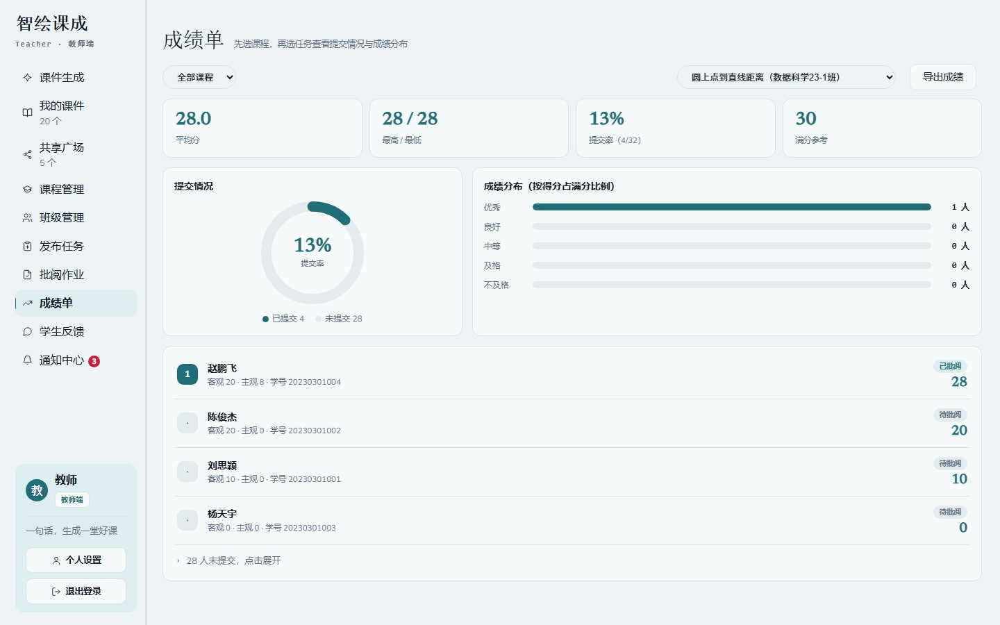

*图 15　成绩单：平均分、最高/最低、提交率、满分参考，下面是提交情况和成绩分布*

操作步骤：

1. 先在左侧“全部课程”下拉框选课程。
2. 再在右侧任务下拉框选具体任务。示例中选择“圆上点到直线距离（数据科学 23-1 班）”后，页面显示平均分 28.0、最高/最低 28/28、提交率 13%（4/32）、满分参考 30。
3. 看“提交情况”圆环：深色是已提交，浅色是未提交；圆环下方标出人数。
4. 看“成绩分布”：按得分占满分比例分成优秀、良好、中等、及格、不及格五档，右侧显示每档人数。
5. 看学生明细：每行显示姓名、客观题/主观题得分、学号和总分，右侧标记“已批阅”或“待批阅”。
6. 未提交学生默认折叠在“28 人未提交，点击展开”一行，点开后可以核对名单。
7. 点右上角“导出成绩”，把当前任务的成绩导出为 CSV 文件。

如果切换任务后页面没有数据，说明这个任务还没有学生提交或还没有批阅记录；换一个任务，或先去“批阅作业”完成批阅。

### 3.10 学生反馈：看学生怎么说

点左侧“学生反馈”，进入反馈汇总页。顶部可按“全部类型 / 全部科目 / 全部班级”筛选，下方四张卡显示反馈总数、评价数、提问数、参与学生数。

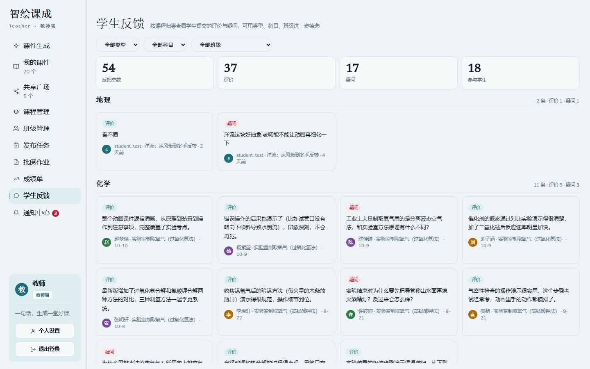

*图 16　学生反馈：按科目分组，蓝色标签是评价，红色标签是提问*

页面按学科分组，每条反馈显示类型、原文、学生姓名、课件名和时间。使用方法：

1. 先用三个下拉框缩小范围，例如只看“数学”或只看“提问”。
2. 在卡片里读学生的原话。评价通常是学习感受，提问通常是具体疑惑。
3. 需要回到对应课件时，记下卡片上的课件名，再到“我的课件”搜索该课件，查看内容或决定是否修改。
4. 当前页面只用于查看和筛选，没有回复输入框；需要回应学生时，在课堂、课程群或其他沟通渠道处理。

### 3.11 通知中心：作业提交与反馈提醒

点左侧“通知中心”，进入消息列表。左侧导航上的红色数字是未读数。页面顶部有“全部标为已读”。

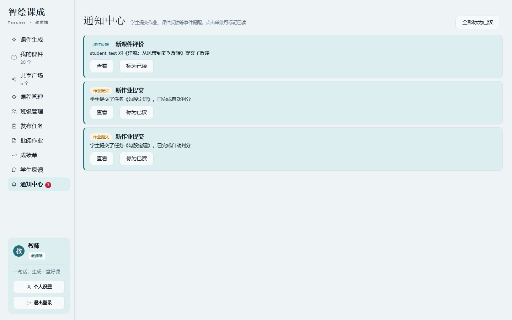

*图 17　通知中心：每条消息带类型标签，可“查看”或“标为已读”*

操作方式：

1. 每条通知左侧有类型标签，例如“课件反馈”“作业提交”。
2. 点“查看”，打开对应课件、作业或反馈所在的页面。
3. 点“标为已读”，只把这一条标为已读，红点数量减一。
4. 点右上角“全部标为已读”，一次清空所有未读。

通知只负责提醒，不代替批阅。看到“新作业提交”后，仍要回到“批阅作业”完成主观题批阅和成绩提交。

### 3.12 个人设置与退出

点左下角“个人设置”，会离开教师工作台，进入独立的个人设置页。页面左边是账号卡，右边是基本资料和修改密码。

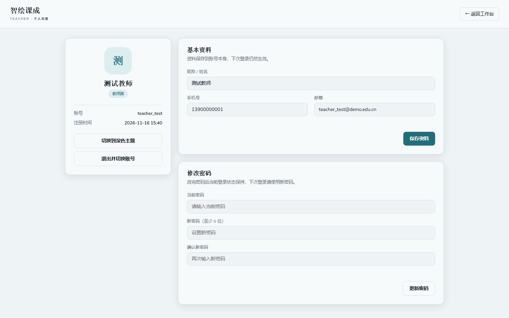

*图 18　教师个人设置：改昵称、手机号、邮箱，或修改密码、切换主题*

操作步骤：

1. **改基本资料**：修改昵称/姓名、手机号、邮箱，点“保存资料”。页面提示资料保存到账号本身，下次登录仍然生效。
2. **换主题**：点左侧“切换到深色主题”，在浅色和深色之间切换；再点一次切回。
3. **改密码**：在“修改密码”里填当前密码、新密码、确认新密码。新密码至少 6 位。点“更新密码”后，当前登录状态保持，下次登录使用新密码。
4. **切换账号**：点左侧“退出并切换账号”，回到登录页。
5. **返回工作台**：点右上角“返回工作台”，回到教师端首页。

左下角“退出登录”也会回到登录页，并弹出确认框；确认后当前账号退出。公用电脑上用完务必退出。

## 四、学生端操作

### 4.1 学生登录与首页

学生登录方式与教师相同，只是在登录弹窗里选择“学生”。登录成功后不会进入 3D 书架，而是直接进入“通知”页。左侧导航依次是：通知、我的任务、我的收藏、我的成绩、我的反馈；左下角是“个人资料”和“退出登录”。

学生端的主区域会随左侧栏目切换，地址不变；只有“个人资料”会打开独立页面。

### 4.2 通知：老师催交和作业提醒

“通知”是学生登录后的默认首页。红色数字表示未读数量。每条通知显示任务名、提醒语和时间；未读通知用浅红底突出。

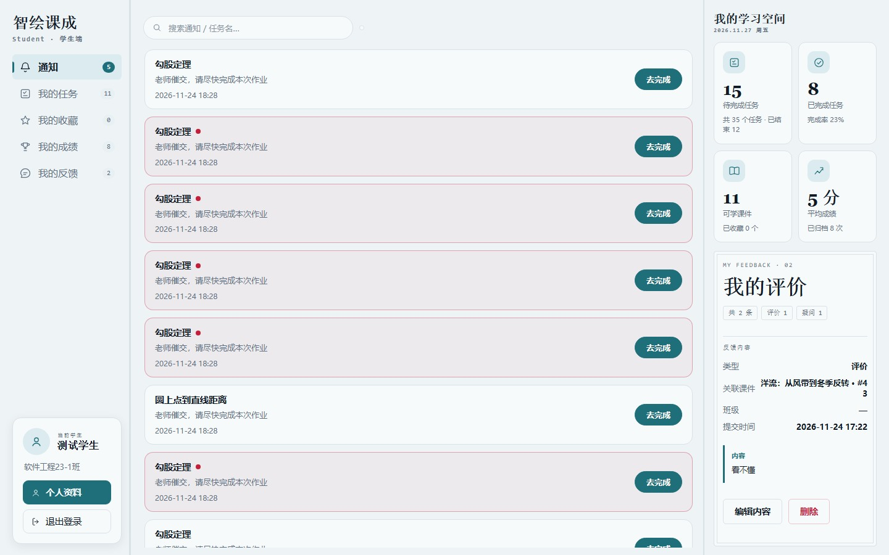

*图 19　学生通知：未读消息浅红底，右侧“去完成”直接进入任务*

操作方式：

1. 读通知标题和正文，确认是哪份课件、什么要求。
2. 点右侧“去完成”，页面会切到“我的任务”，并清掉这条提醒；在任务列表里找到同名卡片，再点“开始学习”。
3. 处理完一条后，未读红点会减少。左侧“通知”旁的计数也会同步变化。

### 4.3 我的任务：按学科找作业

点左侧“我的任务”，进入任务列表。页面按学科分组，每张卡片是一份课件任务；顶部有搜索框和“全部 / 已完成 / 未完成”筛选。

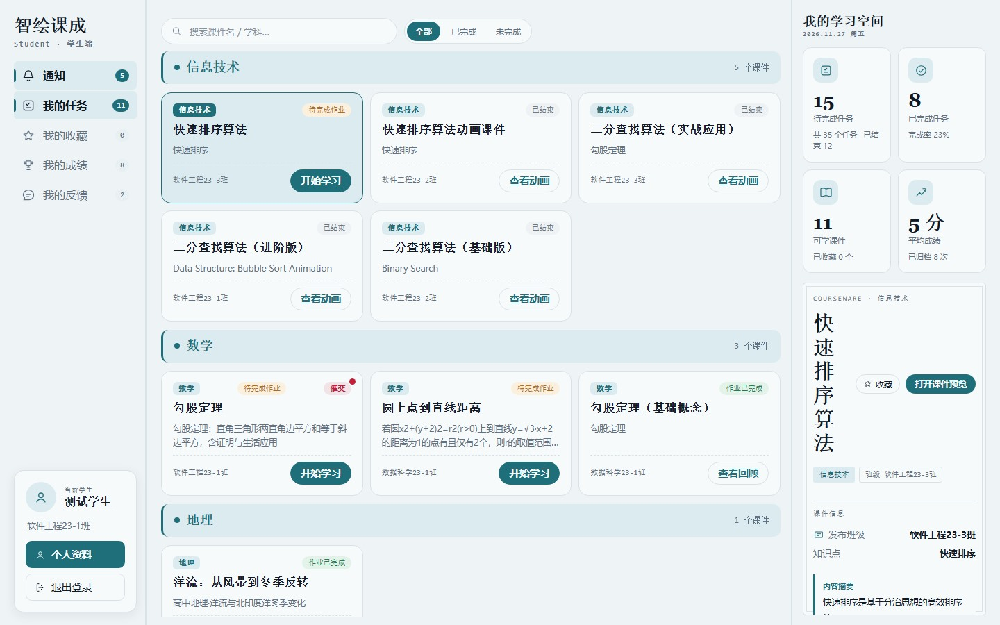

*图 20　我的任务：按学科分组，卡片右下角按钮随任务状态变化*

卡片上的状态和按钮对应关系：

- **待完成作业**：右下角是“开始学习”，点进去做题。
- **已结束**：右下角是“查看动画”，可以看课件动画，但不再进入作答。
- **作业已完成**：右下角是“查看回顾”，回看自己的作答和成绩。
- 右上角带“催交”红色标记：老师发过催交提醒，优先处理。

操作步骤：

1. 用“未完成”筛掉已结束和已完成的卡片，先做待完成作业。
2. 点某张卡片正文，右侧“我的学习空间”会显示这份课件的封面、班级、知识点和内容摘要；点“打开课件预览”可以先看内容。
3. 点“开始学习”，进入全屏动画学习页。
4. 做完提交后，卡片状态会变成“作业已完成”，并从“未完成”里移出。

### 4.4 学习页：看动画，在右侧作答

点“开始学习”后，页面会在同一学生页内打开全屏学习工作台。上方显示“共 3 题”，左上角是课件标题，右上角是“返回”。中间是动画、代码和可视化，右侧是“在线作答”。

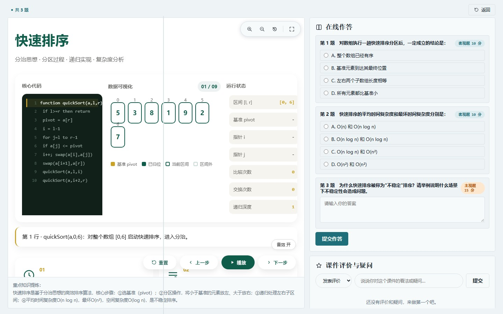

*图 21　学习页：左边看动画和过程，右边逐题作答，底部提交*

操作步骤：

1. **看动画**：中间画布下方有“重置 / 上一步 / 播放 / 下一步”，可以跟着播放进度理解过程；画布右下角可放大、缩小、全屏。
2. **切换视图**：画布上方有“动画 / 代码 / 可视化”等标签，按需要切换。代码视图用于对照算法实现，可视化视图用于看数据变化。
3. **做题**：右侧“在线作答”逐题列出。客观题点选项，主观题在文本框里输入答案。每题右上角标出题型和分值。
4. **提交**：确认所有题目都作答后，点右下角“提交作答”。提交后页面切到这次作答的回顾，任务卡同步变为“作业已完成”；点顶部“返回”回任务列表。
5. **评价课件**：右侧下方有“课件评价与疑问”，可以选“发表评价”或提问，写完后点“提交”。这条内容会出现在教师的“学生反馈”里。
6. **返回**：点右上角“返回”，不提交直接回任务列表。已经作答但未提交的内容是否保留，以页面提示为准。

学习页的题目数量不是固定的，顶部“共 3 题”会随课件实际题目数变化。

### 4.5 我的收藏

点左侧“我的收藏”，进入收藏列表。学生可以在课件详情里点“☆ 收藏”，把课件收进这里。

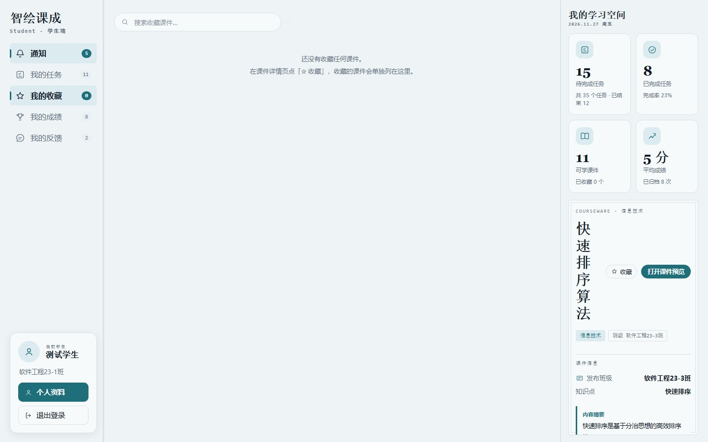

*图 22　我的收藏：没有收藏时显示空状态，右侧仍保留当前课件预览*

操作方式：

1. 顶部搜索框按课件标题过滤。
2. 点卡片打开课件；右侧预览区会显示封面、班级、知识点和摘要。
3. 需要取消收藏时，在课件详情或预览区再点一次收藏按钮。

当前演示账号还没有收藏，所以页面显示“还没有收藏任何课件”。这不是故障，先在课件详情里收藏一份，列表就会出现内容。

### 4.6 我的成绩：看总分、排名和每次作答

点左侧“我的成绩”，进入学习概览。页面上方是已归档成绩次数、平均分、单次最高分、最佳班级排名；下方按科目分组，列出每次成绩。

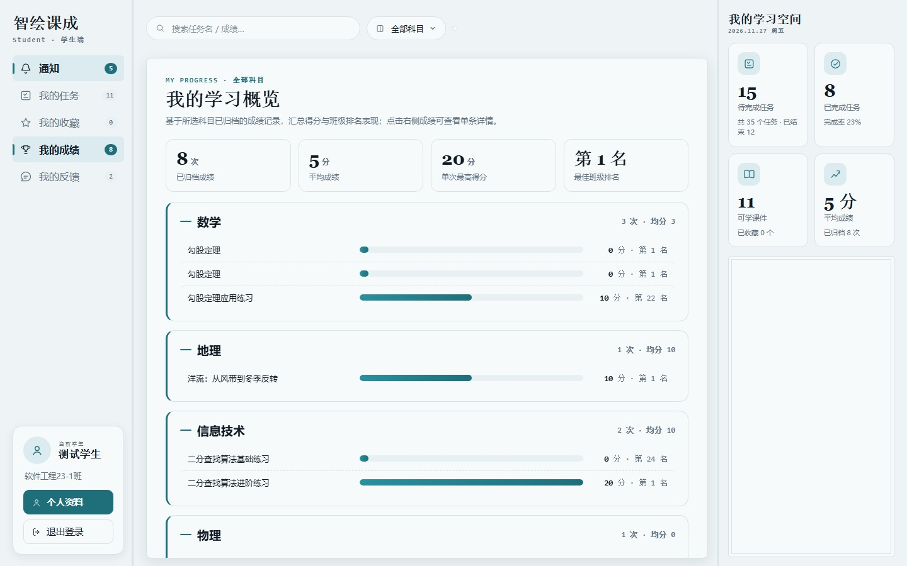

*图 23　我的成绩：按科目分块，每行显示任务名、得分和班级排名*

操作方式：

1. 顶部搜索框按任务名或成绩搜索；“全部科目”下拉框可以只看某一科。
2. 每个科目块右侧显示该科次数和均分。
3. 每行显示任务名、得分条和“得分 · 第 N 名”。得分条越长，说明这次得分越高。
4. 点某一条成绩，中间区域会打开这次作答的回顾，显示总分、逐题对错、作答时长和错题明细；再点返回，回到成绩列表。
5. 页面右侧“我的学习空间”汇总待完成任务、已完成任务、可学课件、平均成绩和已归档次数，可以作为学习进度的总览。

如果某次作业刚提交还没有批阅，成绩可能暂时不出现；等教师在“批阅作业”里提交成绩后再看。

### 4.7 我的反馈：管理自己提的评价和问题

点左侧“我的反馈”，进入反馈记录。顶部可按课件筛选，右侧有“全部 / 评价 / 疑问”三个标签。页面上方统计累计反馈、课件评价、提出疑问和涉及课件数。

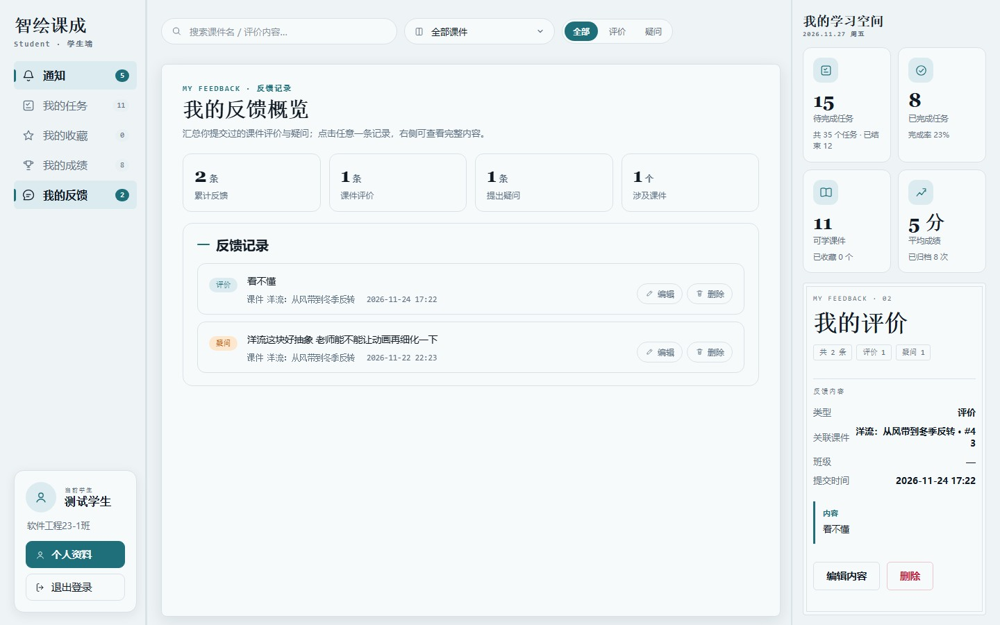

*图 24　我的反馈：左侧是反馈列表，右侧是选中记录的完整内容*

操作方式：

1. 点某条反馈，右侧显示完整内容、类型、关联课件、班级和提交时间。
2. 点“编辑”，修改这条评价或疑问的正文，保存后列表同步更新。
3. 点“删除”，移除这条反馈。删除前确认内容，避免误删仍在被老师查看的问题。
4. 需要新增反馈时，回到对应课件的学习页，在“课件评价与疑问”里发表。

### 4.8 个人资料与退出

点左下角“个人资料”，进入独立的学生个人资料页。左边是账号卡，显示学号、年级、专业、性别、手机号、邮箱、注册时间，以及“我的任务 / 归档成绩 / 我的收藏”三个数字。右边是基本资料和修改密码。

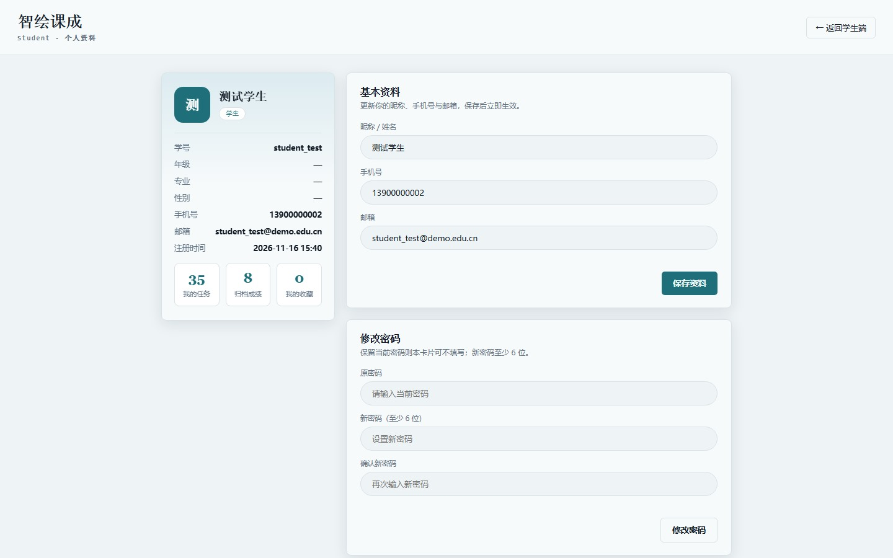

*图 25　学生个人资料：账号信息、学习数据、资料修改和密码修改集中在一页*

操作步骤：

1. **改资料**：修改昵称/姓名、手机号、邮箱，点“保存资料”。保存后立即生效。
2. **改密码**：填写原密码、新密码、确认新密码。新密码至少 6 位。点“修改密码”完成。
3. **返回学生端**：点右上角“返回学生端”，回到刚才的学生页面。
4. **退出登录**：点左下角“退出登录”，弹出确认框，确认后回到登录页。

如果账号卡里的年级、专业、性别显示为“—”，说明演示账号没有补全这些字段；这不影响做作业和看成绩，需要时由教师在班级名单里维护。

## 五、一条完整的教学闭环

第一次演示时，可以按下面这条路线走一遍，能看到“建课 → 生成 → 发布 → 学习 → 批阅 → 成绩”的完整闭环。

| 顺序 | 谁操作 | 操作路线 | 看到的结果 |
| --- | --- | --- | --- |
| 1 | 教师 | 课程管理 → + 新建课程 → 填名称 → 保存 | 课程卡片出现在列表 |
| 2 | 教师 | 课件生成 → 输入知识点 → 生成课件 | 三栏工作台出现动画和知识点 |
| 3 | 教师 | 我的课件 → 找到课件 → 发布共享（可选） | 课件进入共享广场 |
| 4 | 教师 | 发布任务 → 选课件 → 发布 → 选班级 → 确认发布 | 学生端“我的任务”出现待完成卡片 |
| 5 | 学生 | 通知 → 去完成，或我的任务 → 开始学习 | 进入动画学习页，右侧作答 |
| 6 | 学生 | 作答 → 提交作答 | 任务变为“作业已完成” |
| 7 | 教师 | 批阅作业 → 选科目 → 去批阅 → 提交成绩 | 学生成绩进入成绩单 |
| 8 | 教师 | 成绩单 → 选课程和任务 | 看到平均分、提交率、分布和学生明细 |

演示时建议用两个浏览器窗口，或一个普通窗口加一个无痕窗口，分别登录教师和学生账号。这样发布、提交、批阅的页面变化可以同时看到。

## 六、常见问题

**点了左侧栏目，地址栏没有变化，是不是没跳转？**

不是。教师端和学生端的大部分栏目都是单页内切换，主区域内容已经变化，左侧当前栏目会高亮。只有“个人设置”“个人资料”会进入独立页面。

**教师登录后为什么没有看到课程列表？**

教师登录默认落在“课件生成”的 3D 书架，不是课程管理。点左侧“课程管理”才进入课程卡片页；点“我的课件”则进入课件列表。

**发布任务后，学生端没有马上出现？**

先确认发布时选对了班级，再看学生账号是否属于该班。教师端“发布任务”切到“已发布”可以核对；学生端下拉刷新或重新进入“我的任务”。

**批阅作业里没有待批学生？**

说明当前科目没有待批记录，或任务还没有学生提交。先看统计区的“待批阅”数量，再确认科目；没有提交时，去“成绩单”看提交率。

**成绩单里任务没有数据？**

成绩单只显示有提交或已批阅记录的任务。换一个任务；如果任务刚发布，等学生提交后再看。

**学生收藏页是空的？**

收藏需要主动添加。先打开一份课件，在详情或右侧预览区点“☆ 收藏”，再回“我的收藏”就能看到。

**为什么学生成绩里有些任务没有分数？**

任务可能还没有批阅，或已经结束但没有提交。教师完成批阅并“提交成绩”后，学生端才会出现归档成绩。

---

需要重新部署或初始化演示数据时，启动步骤、数据库脚本和默认配置见项目根目录的 README；本文只讲界面操作，不包含代码和命令。
